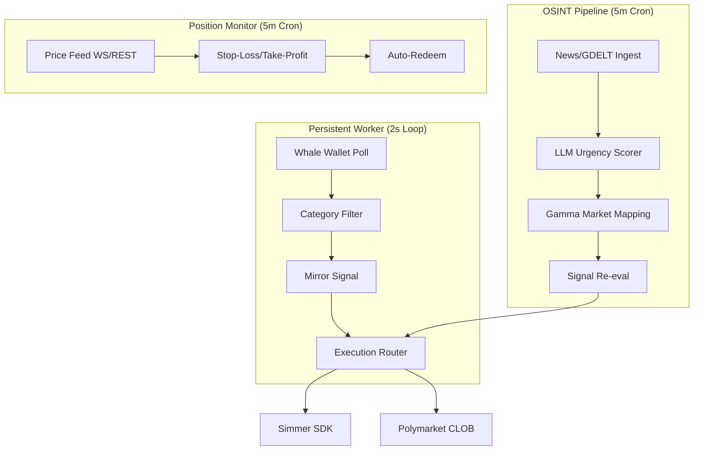

# Polymarket Geopolitical Trading Agent

Autonomous agent that monitors multi-category OSINT feeds, maps high-urgency events to Polymarket prediction contracts, and executes trades with automatic position management.

## Hybrid Architecture

The system operates using two decoupled execution paths to balance speed and resource efficiency:

1.  **Low-Latency Worker (Persistent)**: Polls high-frequency sources (copytrade wallets) every 2 seconds for immediate execution.
2.  **OSINT Pipeline (Scheduled)**: Ingests news feeds and GDELT every 5 minutes, performing multi-stage LLM analysis (scoring → mapping → execution).



### Execution Flow Details

| Flow | Logic | Interval | Priority |
| :--- | :--- | :--- | :--- |
| **Copytrade** | Latency-critical. Mirrors expert wallets immediately. | 2 seconds | High |
| **OSINT** | Context-heavy. Monitors global events and maps to markets. | 5 minutes | Medium |
| **Monitor** | Maintenance. Manages exits and redemptions. | 5 minutes | N/A |


### Ingestion Categories (Phase 5)

All ingestion categories use a shared `CategoryConfig` interface:

```ts
interface CategoryConfig {
  id: string;
  label: string;
  feeds: { url: string; headers?: Record<string, string> }[];
  scorerPrompt: string;
  scoreThreshold: number;
  entityContext: string;
}
```

| Category | ID | Threshold |
|---|---|---|
| Geopolitical | `geopolitical` | 8 |
| Macro / Central Bank | `macro` | 8 |
| Crypto / Regulatory | `crypto-regulatory` | 8 |
| AI / Tech Company Events | `ai-tech` | 7 |
| US Politics (Non-Election) | `us-politics` | 7 |

### Data Flow Summary

| Cycle | Entrypoint | What happens |
|-------|-----------|--------------|
| **Copytrade** (`worker:copytrade`) | `src/copytrade/worker.ts` | **Persistent Worker**: Parallel wallet polling → fetch high-frequency trades → filter by category keywords → apply liquidity-aware sizing → execute via Simmer/CLOB |
| **Trade** (`cron:trade`) | `src/execution/index.ts` | **OSINT Pipeline**: Ingest multi-category news → score per category → map to markets → context check → execute new trades |
| **Monitor** (`cron:monitor`) | `src/monitor/index.ts` | Resolve prices via WS cache → evaluate stop-loss / take-profit / divergence → exit if triggered → auto-redeem resolved winning positions |
| **Spot** (`cron:spot`) | `src/spot/index.ts` | Poll spot prices → detect significant moves → cross-check Simmer oracle opportunities → execute correlated trades |

### Exit Priority

| Priority | Trigger | Cost | Where |
|----------|---------|------|-------|
| 1 | **Stop-loss** — loss ≥ 30% | Free (price check) | Monitor cycle |
| 2 | **Take-profit** — gain ≥ 25% | Free (price check) | Monitor cycle |
| 3 | **Signal re-eval** — edge evaporated | LLM call | Trade cycle |
| 4 | **Divergence closed** — market reached consensus | Free (price check) | Monitor cycle |

### Execution Venues (Model B — venue-aware lifecycle)

| Venue | When used | Auth |
|-------|-----------|------|
| **Simmer** (primary) | Market exists in Simmer catalogue | `SIMMER_API_KEY` |
| **Polymarket CLOB** (fallback) | Market not in Simmer | `POLYGON_WALLET_PRIVATE_KEY` (local signing) |

Each position records its `executionVenue` (`simmer` or `clob`). The full lifecycle — entry, take-profit exit, and redemption — routes through the venue that opened the position. CLOB positions are exited via `submitClobSell` and redeemed by checking the Gamma API for market resolution status.

### 4. High-Speed Arbitrage Mode (Optional)

For real-time arbitrage (sub-second latency), run the dedicated worker and price feeds instead of the standard cron:

```bash
# Start real-time Binance/Solana feeds
npm run worker:spot-feed

# Start the long-running arb worker
npm run worker:arb
```

The worker uses **Binance WebSockets** and **Helius/Pyth on-chain data** to detect massive price moves and front-run Polymarket adjustments. See [docs/arbitrage-worker.md](docs/arbitrage-worker.md) for more details.

## 📁 Architecture

- `COPYTRADE_ENABLED` — master switch
- `COPYTRADE_WALLETS` — comma-separated profile addresses
- `COPYTRADE_MARKET_SCOPE` —    *   **Scope Filtering**: Limit copying to specific domains by keyword (`geopolitics`, `weather`, `sports`, `crypto`, `macro`, `ai-tech`, `us-politics`).
- `COPYTRADE_SIZE_SCALE` — scale factor vs observed USDC size (e.g. 0.1 mirrors 10% of whale size)
- `COPYTRADE_MAX_STAKE_USD` — cap per trade
- `COPYTRADE_MAX_SLIPPAGE_BPS` — skip if price moved too far (200 bps = 2%)
- `COPYTRADE_MIN_TIME_TO_RESOLVE_HOURS` — skip near-resolution markets
- `COPYTRADE_MIN_LIQUIDITY` — skip thin markets
- `COPYTRADE_EXIT_MODE` — `mirror` (follow whale sells) or `rules` (standard PGA exits)
- `COPYTRADE_POLL_INTERVAL_MS` — worker loop speed (default 2s)

Copytrade shortlist automation (weekly refresh of `COPYTRADE_WALLETS`):

- `COPYTRADE_SHORTLIST_TIME_WINDOW` — `DAY` | `WEEK` | `MONTH` | `ALL`
- `COPYTRADE_SHORTLIST_TOP_N` — number of wallets to apply
- `COPYTRADE_SHORTLIST_MIN_PNL_USD` — minimum PnL filter (USD)
- `COPYTRADE_SHORTLIST_MIN_VOL_USD` — minimum volume filter (USD)
- `COPYTRADE_SHORTLIST_AUTO_APPLY` — update `.env` automatically (`true`/`false`)

Run (cron example):

```bash
# Weekly shortlist refresh (Mon 06:00 GMT)
0 6 * * MON /home/romeofolie/Projects/polymarket-geopolitical-agent/run.sh \
  npm run cron:shortlist \
  >> /tmp/pga-copytrade-shortlist.log 2>&1
```

### CLOB Account Modes

| Signature Type | Value | Description | Requires `POLYMARKET_FUNDER_ADDRESS` |
|----------------|-------|-------------|--------------------------------------|
| EOA | `0` | Direct browser/EOA wallet (default) | No |
| POLY_PROXY | `1` | Polymarket proxy (magic/email wallet) | Yes |
| POLY_GNOSIS_SAFE | `2` | Gnosis Safe multisig | Yes |

Set `POLYMARKET_SIGNATURE_TYPE` in `.env`. Types 1 and 2 require `POLYMARKET_FUNDER_ADDRESS` — startup will fail if it's missing.

### CLOB Startup Probe

The monitor entrypoint runs `runClobProbe()` at startup. It logs:
- Signer and funder addresses
- Signature type
- USDC collateral balance and allowance
- Open CLOB order count

This is fire-and-forget — probe failures are logged but never crash the process.

### Price Resolution

All price lookups go through `resolveYesPrice()`, which checks the CLOB WebSocket cache (Redis, 30s TTL) before falling back to Gamma REST. A single `ClobPriceFeed` singleton subscribes to market order-book updates for all watched markets:

- High-urgency OSINT markets are subscribed when they enter the divergence calculator
- Spot-triggered correlated markets are subscribed at trade time
- Open position markets are subscribed at monitor startup

Set `WS_ENABLED=false` to disable WebSocket subscriptions (REST-only mode; useful in test environments).

### Pre-Trade Context Check (Simmer)

Before every Simmer trade, `executor.ts` calls `GET /api/sdk/context/{market_id}` and skips the trade if:

- Market is resolved or closed
- Simmer already sees an open position on the same side (prevents doubling up)
- Simmer flags a severe flip-flop warning (signal instability)
- Market has fees (fee drag erodes geopolitical edge at typical stake sizes)

### Auto-Redemption

The monitor cycle automatically redeems winning positions on resolved markets via the Simmer API (`resolutionRedeemer.ts`). Redemptions are Telegram-notified with the profit amount.

### Timing Window Multiplier

OSINT urgency scores are boosted by a regional timing window after LLM scoring:

| Window (UTC) | Region | Multiplier | Rationale |
|---|---|---|---|
| 00:00 – 08:00 | Asia/Pacific | ×1.20 | US asleep — geopolitical repricing lag is widest |
| 06:00 – 14:00 | Europe/Middle East | ×1.15 | US waking — partial repricing lag |
| Outside windows | — | ×1.00 | No adjustment |

Scores are capped at 10. Configure via `TIMING_WINDOW_ENABLED` (default `true`).

## Setup

```bash
# 1. Start Redis
docker run -d --name pga-redis --restart unless-stopped -p 6379:6379 redis:alpine
# REDIS_URL=redis://localhost:6379
#
# Or use a custom port (e.g. if 6379 is taken):
# docker run -d --name pga-redis --restart unless-stopped -p 6385:6379 redis:alpine
# REDIS_URL=redis://localhost:6385

# 2. Install dependencies
npm install

# 3. Configure environment
cp .env.example .env
# Required: REDIS_URL, SIMMER_API_KEY, OPENAI_API_KEY (or GEMINI_API_KEY),
#           TELEGRAM_BOT_TOKEN, TELEGRAM_CHAT_ID, POLYGON_WALLET_PRIVATE_KEY
# See .env.example for all optional tuning knobs.

# 4. Verify build
npm run build

# 5. Probe Simmer connectivity
npm run probe:simmer

# 6. Initialize Copytrade Shortlist (Highly Recommended)
# Fetches the top-performing whale wallets for Copytrade.
npm run cron:shortlist

# 7. Start the Low-Latency Worker
# It is recommended to run this using a process manager like PM2
npm run worker:copytrade

# 8. Run scheduled monitor cycles via cron (every 5 min)
# See crontab example below.
```

### Running the Agent

The agent uses a hybrid architecture: a **persistent worker** for high-frequency signals (Copytrade) and **cron jobs** for periodic maintenance/OSINT tasks.

#### Persistent Worker (Copytrade)
Run the worker directly or using `pm2` for reliability:
```bash
# Direct
npm run worker:copytrade

# With PM2 (Recommended)
pm2 start "npm run worker:copytrade" --name pga-worker
```

#### Scheduled Jobs (Cron)
Cron jobs handle the broader OSINT pipeline and position monitoring. A `run.sh` wrapper script is included to manage `.env` loading and use `flock(1)` to prevent overlapping runs.

```cron
PATH=/usr/local/bin:/usr/bin:/bin

# OSINT News Pipeline (Every 5 min)
*/5 * * * * /path/to/polymarket-geopolitical-agent/run.sh npx tsx /path/to/polymarket-geopolitical-agent/src/execution/index.ts >> /tmp/pga-trade.log 2>&1

# Position Monitor (Every 5 min)
*/5 * * * * /path/to/polymarket-geopolitical-agent/run.sh npx tsx /path/to/polymarket-geopolitical-agent/src/monitor/index.ts >> /tmp/pga-monitor.log 2>&1

# Spot Price Monitor (Every 1 min)
* * * * *   /path/to/polymarket-geopolitical-agent/run.sh npx tsx /path/to/polymarket-geopolitical-agent/src/spot/index.ts >> /tmp/pga-spot.log 2>&1

# Arbitrage Scanner (Every 15 min)
*/15 * * * * /path/to/polymarket-geopolitical-agent/run.sh npx tsx /path/to/polymarket-geopolitical-agent/src/arb/index.ts >> /tmp/pga-arb.log 2>&1

# Copytrade Shortlist Refresh (Every Monday at 6 AM)
0 6 * * MON /path/to/polymarket-geopolitical-agent/run.sh npx tsx /path/to/polymarket-geopolitical-agent/src/copytrade/shortlist.ts >> /tmp/pga-copytrade-shortlist.log 2>&1
```

### Monitoring & Logs

The agent follows a standard logging pattern. You can monitor the system in real-time by tailing the relevant log files (as defined in your crontab/PM2 config):

| Component | Fast Tailing Command |
| :--- | :--- |
| **OSINT Pipeline** | `tail -f /tmp/pga-trade.log` |
| **Copytrade Worker** | `pm2 logs pga-worker` OR `tail -f /tmp/pga-copytrade.log` |
| **Position Monitor** | `tail -f /tmp/pga-monitor.log` |
| **Spot Price Feed** | `tail -f /tmp/pga-spot.log` |

#### Overlap protection

| Layer | Applies to | Mechanism | Protects against |
|---|---|---|---|
| `flock` in `run.sh` | All pipelines | OS-level file lock per script (`/tmp/pga-<script>.lock`) | Second cron tick firing while prior OS process is still alive |
| Redis overlap lock | `execution`, `monitor`, `spot` | Token-based `SET ... EX NX` + Lua compare-and-delete release | Slow cycle (LLM latency, Simmer API) running longer than the lock TTL; prevents a long-running process from releasing a lock it no longer owns |
| WebSocket feed cleanup | `monitor`, `spot` | `destroyPriceFeed()` in `finally` | Open WS connection holding the Node event loop open after work is done |

The Redis lock uses token-based ownership: each run stores a unique token on acquire and releases with a Lua script that only deletes if the stored value still matches. This prevents an expired long-running process from evicting a newer run's lock.

`arb` only uses `flock` (its cycles are short and have no WS feed); the Redis lock applies to the three pipelines that make LLM calls.

## Scripts

| Script | Description |
|---|---|
| `npm run build` | TypeScript type-check (no emit) |
| `npm run probe:simmer` | Verify Simmer SDK connectivity |
| `npm run cron:trade` | Run the full trade pipeline (ingest → map → re-eval → execute) |
| `npm run cron:monitor` | Run the position monitor (stop-loss / take-profit / divergence) |
| `npm run cron:spot` | Run the spot price monitor (price moves → correlated market trades) |
| `npm run lint` | ESLint |
| `npm run format` | Prettier |
| `npm test` | Jest tests |

## Module Documentation

| Module | README | Description |
|--------|--------|-------------|
| `src/shared/` | [README](src/shared/README.md) | Config, Redis client, Simmer SDK wrapper (`context` + `opportunities` endpoints), CLOB WebSocket feed, price cache, logger |
| `src/ingestion/` | [README](src/ingestion/README.md) | RSS + GDELT ingestion, Redis dedup, LLM urgency scoring, timing window multiplier |
| `src/ingestion/categories/` | [README](src/ingestion/categories/README.md) | CategoryConfig registry for multi-category ingestion (feeds, scorer prompts, thresholds, entity context) |
| `src/mapping/` | [README](src/mapping/README.md) | Gamma API client, entity extraction, consensus probability, Half-Kelly sizing |
| `src/execution/` | [README](src/execution/README.md) | Simmer pre-trade context check, execution router, Redis position ledger, Telegram notifications |
| `src/monitor/` | [README](src/monitor/README.md) | WS-backed price resolution, stop-loss / take-profit / divergence evaluator, auto-redemption of resolved positions |
| `src/spot/` | — | Spot price monitor: polls CoinGecko/Yahoo Finance, Simmer oracle cross-check, correlates to Polymarket, executes trades |

## Phases

See [docs/PHASES.md](docs/PHASES.md) for the full phase breakdown.
See [docs/PRD.md](docs/PRD.md) for product requirements.

## Environment Variables

See `.env.example` for full documentation of all required and optional variables.

## Development Notes

- **One PR per phase.** Tasks within a phase are tracked as GitHub sub-issues under the phase epic.
- **Romeo merges all PRs.** Never merge your own work.
- Phase 0: scaffolding + Simmer SDK validation.
- Phase 1: ingestion & urgency scoring.
- Phase 2: market mapping & execution logic.
- Phase 3: execution orchestration & Telegram notifications.
- Phase 4: position monitor & take-profit.
- Phase 5: multi-category market expansion.
- Phase 6: spot price monitor — parallel signal source from live asset prices.
