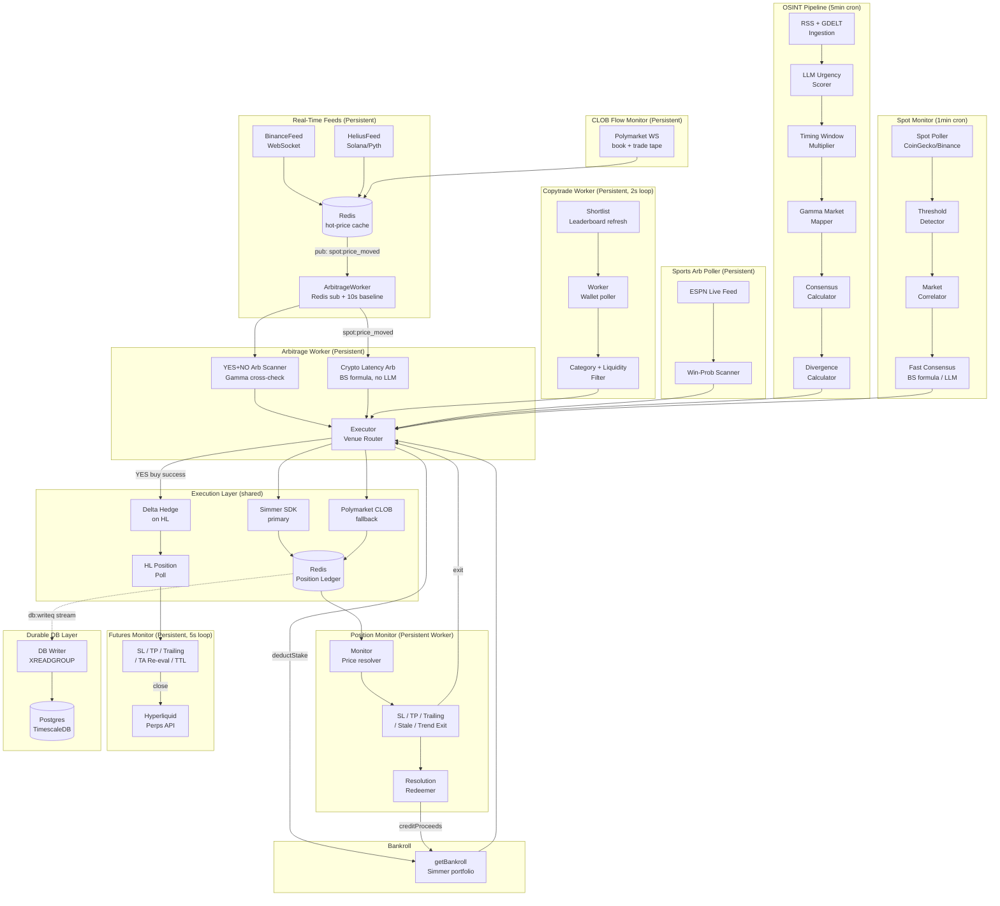

# Polymarket Geopolitical Trading Agent

Autonomous multi-signal trading agent for Polymarket prediction markets. Combines OSINT pipelines, whale wallet mirroring, real-time spot price arbitrage, crypto latency arbitrage, sports in-play arbitrage, CME settlement arb, longshot bias exploitation, NOAA weather arb, cross-market correlation arb, Hyperliquid futures hedging, and continuous self-improvement (outcome tracking, context injection, calibration) into a single risk-managed system.

---

## Architecture Overview

The system runs as **13 Docker Compose services** — eight persistent workers, one bootstrap container, and four infrastructure services (Redis, Postgres/TimescaleDB, DB migrator, DB writer) — plus host-level cron jobs for periodic pipelines. All signals route through a shared execution layer with a continuous improvement feedback loop.



---

## Deployment

Everything runs via **Docker Compose** on a Hetzner CAX11 ARM box. No PM2.

```bash
# Deploy / redeploy
scripts/deploy.sh pga-futures
scripts/deploy.sh pga-arb pga-spot-feed
scripts/deploy.sh --all   # only for intentional full-stack deploys

# Verify
docker compose ps
redis-cli KEYS '*lock*'   # should be empty or only active worker locks
```

Periodic pipelines run via host crontab (not Docker). See [Crontab](#crontab) below.

---

## Services (Docker Compose)

| Container | Command | Type | Purpose |
|-----------|---------|------|---------|
| **redis** | `redis-server --appendonly yes` | Infrastructure | Central state store |
| **pga-bootstrap** | Lua lock cleanup | Init (run-once) | Clears stale `lock:*` keys before workers start |
| **pga-spot-feed** | `src/spot/feeds/manager.ts` | Persistent worker | Binance WS + Helius Solana feeds → Redis hot-price cache → publish `spot:price_moved` |
| **pga-arb** | `src/arb/worker.ts` | Persistent worker | YES+NO arb sweep (10s baseline) + crypto latency arb (BS formula on every `spot:price_moved`) |
| **pga-copytrade** | `src/copytrade/worker.ts` | Persistent worker | Mirror expert whale wallets with category/liquidity/slippage guardrails (2s poll loop) |
| **pga-monitor** | `src/monitor/worker.ts` | Persistent worker | PM position monitoring: SL/TP, trailing stop, stale exit, trend exit, signal re-eval, divergence close, resolution redemption |
| **pga-futures** | `src/monitor/futuresMonitor.ts` | Persistent worker | HL perp monitoring: SL/TP, trailing stop, max-hold, TA re-eval (5s poll) |
| **pga-telegram** | `src/ingestion/telegramMonitor.ts` | Persistent worker | MTProto listener for OSINT channels → immediate scoring → execution |
| **pga-clob-flow** | `src/clob/flowMonitor.ts` | Persistent worker | Streams Polymarket book/trade tape into Redis |
| **pga-sports** | `src/sports/poller.ts` | Persistent worker | NBA/NHL in-play win-probability edge vs Polymarket |
| **pga-db** | TimescaleDB (pg16) | Infrastructure | Durable analytics database (TimescaleDB + pgvector) |
| **pga-db-migrate** | `node-pg-migrate up` | Init (run-once) | Applies schema migrations on deploy |
| **pga-db-writer** | `src/db/writer/index.ts` | Persistent worker | XREADGROUP consumer draining `db:writeq` Redis stream into Postgres |
| **pga-cron** | `embedTradeMemory` + `snapshotTelemetry` | Persistent (24h loop) | Nightly analytics: trade memory embeddings + telemetry snapshots |
| **pga-db-backup** | `pg_dump` | Persistent (24h loop) | Nightly compressed Postgres backup with 7-day retention |

## Crontab (host-level)

| Schedule | Job | Log |
|----------|-----|-----|
| `*/5 * * * *` | OSINT trade pipeline (`src/execution/index.ts`) | `~/logs/pga/trade.log` |
| `* * * * *` | Spot price monitor (`src/spot/index.ts`) | `~/logs/pga/spot.log` |
| `*/30 * * * *` | Watchlist refresh (`src/cron/refreshWatchlist.ts`) | `~/logs/pga/watchlist.log` |
| `*/30 * * * *` | Near-zero entry scanner (`src/cron/nearZeroScanner.ts`) | `~/logs/pga/near-zero.log` |
| `* * * * *` | Settlement arb scanner (`src/cron/settlement.ts`) | `~/logs/pga/settlement.log` |
| `0 */2 * * *` | Longshot bias scanner (`src/cron/longshotScanner.ts`) | `~/logs/pga/longshot.log` |
| `30 */6 * * *` | Weather scanner (`src/weather/weatherScanner.ts`) | `~/logs/pga/weather.log` |
| `*/5 * * * *` | Rebate farmer (`src/cron/rebateFarmer.ts`) | `~/logs/pga/rebate.log` |
| `*/30 * * * *` | Residual sweep (`scripts/sweep-residuals.ts`) | `~/logs/pga/sweep-residuals.log` |
| `0 */6 * * *` | Health check (`scripts/health-check.ts`) | `~/logs/pga/health-check.log` |
| `0 6 * * *` | Copytrade shortlist refresh (`src/copytrade/shortlist.ts`) | `~/logs/pga/copytrade-shortlist.log` |
| `0 3 * * MON` | Calibration stats (`src/cron/calibrate.ts`) | `~/logs/pga/calibrate.log` |
| `0 4 * * *` | Log rotation (`scripts/rotate-logs.sh`) | — |

---

## Data Flow Details

### 1. OSINT Pipeline (`cron:trade`)

```
RSS feeds + GDELT
  → LLM urgency scorer (per-category prompts, score 1–10)
  → Timing window multiplier (×1.20 Asia, ×1.15 EU/ME windows)
  → Gamma API market search (entity extraction + keyword match)
  → Multi-sample LLM consensus probability estimate
  → Half-Kelly divergence sizing
  → Execution Router
```

Five ingestion categories run in parallel per tick:

| Category | ID | Score Threshold |
|---|---|---|
| Geopolitical | `geopolitical` | 8 |
| Macro / Central Bank | `macro` | 8 |
| Crypto / Regulatory | `crypto-regulatory` | 8 |
| AI / Tech | `ai-tech` | 7 |
| US Politics | `us-politics` | 7 |

Timing window boosts are applied after LLM scoring and are capped at 10:

| UTC Window | Region | Multiplier |
|---|---|---|
| 00:00 – 08:00 | Asia/Pacific | ×1.20 |
| 06:00 – 14:00 | Europe/Middle East | ×1.15 |
| Outside windows | — | ×1.00 |

### 2. Copytrade Worker (`worker:copytrade`)

```
Polymarket leaderboard API (weekly shortlist refresh)
  → COPYTRADE_WALLETS list
  → 2s poll loop: fetch recent trades per wallet
  → Category keyword filter (geopolitics, crypto, macro, etc.)
  → Minimum payout ratio gate (COPYTRADE_MIN_PAYOUT_RATIO)
  → Minimum edge magnitude gate (COPYTRADE_MIN_EDGE_MAGNITUDE)
  → Liquidity / slippage / time-to-resolve guards
  → Stake scaling (COPYTRADE_SIZE_SCALE × observed whale size, capped at COPYTRADE_MAX_STAKE_USD)
  → Execution Router
```

Shortlist auto-refresh queries the leaderboard by PnL/volume thresholds and optionally updates `.env` automatically (`COPYTRADE_SHORTLIST_AUTO_APPLY=true`).

### 3. Spot → Arb Path (`worker:spot-feed` + `worker:arb`)

```
BinanceFeed (WebSocket) — assets: BTC, ETH, SOL, XRP, BNB, TAO, DOGE, ADA, AVAX, LINK, SUI
HeliusFeed (Helius/Pyth) — SOL price
  → Redis hot-price cache (per-symbol)
  → Publish `spot:price_moved` event

ArbitrageWorker — two independent arb paths run on every event:

  Path A — YES+NO combined arbitrage (baseline + fast-path):
    Fast-path: spot:price_moved → immediate sweep trigger
    Baseline:  10s interval sweep (catches moves missed between events)
    → Scan 1,000 active markets: yesAsk + noAsk < $1.00 - fees
    → Execute both legs sequentially (YES first, NO only if YES fills)

  Path B — Crypto latency arbitrage (fast-path only):
    spot:price_moved → map symbol to asset → find correlated PM price-target markets
    → Redis market cache (1h TTL, fallback to Gamma search)
    → Fetch current PM price from WS cache (sub-second)
    → Compute fair value: Black-Scholes binary formula (<1ms, no LLM)
    → edge = |fairValue - pmPrice| - fees
    → If edge > CRYPTO_ARB_MIN_EDGE (default 8%): execute directional trade
    → 5-min dedup per (marketId, direction)

  Shared: Unified Global Governor (Redis-backed, shared Polymarket rate limits across all processes)
  → Execution Router
```

### 4. Spot Monitor (`cron:spot`)

```
Spot Poller (CoinGecko REST, configurable assets + lookback window)
  → Threshold Detector (% move OR z-score trigger, per-asset cooldown via Redis)
  → Market Correlator (Gamma search + LLM correlation direction, cached 24h)
  → Fast Consensus Estimator:
      price-target markets → Black-Scholes binary formula (<1ms, no API)
      event markets       → LLM ensemble (same as OSINT pipeline)
  → Divergence Calculator → Execution Router
```

### 5. Sports Arb Poller (`pga-sports`)

```
ESPN live game feed (NBA/NHL)
  → Win-probability scanner (real-time game state)
  → Compare vs Polymarket odds
  → Edge detection → Execution Router
```

### 6. Near-Zero Entry Scanner (`cron:nearZeroScanner`)

```
Active Polymarket markets with prices near zero (<5¢)
  → Multi-outcome gate + heuristic regex filter
  → OSINT prioritization (recent headlines for the market topic)
  → Near-zero-specific LLM consensus prompt
  → Direction-aware edge calculation
  → Velocity dead-horse filter (blocks markets trending toward zero)
  → Execution Router
```

### 7. Settlement Arb Scanner (`cron:settlement`)

```
CME commodity futures (Yahoo: GC=F, SI=F, CL=F, ES=F, NQ=F)
  → Match Polymarket binary markets by keyword ("Gold above $X on date?")
  → Extract strike price from question text
  → Compute implied probability: sigmoid((spot - cutoff) / smoothing_band)
  → Compare implied vs market price → edge detection
  → Fires in the ~5min window before CME settlement print
  → Execution Router
```

Designed for the moment when the front-month future is the best proxy for settlement outcome. Currently log-only (`SETTLEMENT_ARB_ENABLED=false`).

### 8. Longshot Bias Scanner (`cron:longshotScanner`)

```
Active Polymarket markets with YES price 3-15¢
  → Category-specific optimism gap (entertainment ~5pp, sports ~2pp, political ~3pp)
  → Exempt well-calibrated domains (crypto, macro)
  → Spread gate: NO price within 5¢ of expected complement (tight books only)
  → Buy NO (bet against retail optimism)
  → Execution Router
```

Exploits the favorite-longshot bias from Whelan's study of 300K contracts: cheap YES is systematically overpriced by retail. The opposite strategy to the near-zero scanner.

### 9. Weather Scanner (`weather/weatherScanner`)

```
Gamma API search for weather markets ("High temp in [city] above X°F on date?")
  → Parse city, date, threshold from question text
  → Fetch NOAA/NWS forecast for that city+date
  → Compute exceedance probability from forecast distribution
  → Compare forecast probability vs market price
  → Research-backed theta=0.69 overconfidence adjustment for <48h markets
  → Execution Router
```

Edge source: NOAA forecasts update every 6h while Polymarket weather prices reprice slowly.

### 10. Calibration Bias Adjustment (inline in divergence calculator)

```
LLM consensus probability estimate
  → Look up per-category calibration theta (from weekly recalibration stats)
  → Apply power-law correction: adjusted = P^theta
  → Categories where theta > 1 are overconfident → corrected downward
  → Feeds into Half-Kelly sizing with bias-adjusted probability
```

Not a standalone scanner. Runs inline during every OSINT trade evaluation when `CALIBRATION_BIAS_ENABLED=true`.

### 11. Cross-Market Correlation Arb (`cron:correlationDiscovery` + `cron:correlationScanner`)

```
Discovery (every 6h):
  Cached markets → entity extraction (keyword tokenization)
    → Reverse-index pair finder (shared token overlap, O(N×E))
    → LLM relationship classifier (implication or mutual-exclusion)
    → Persist constraint edges in Redis graph (7-day TTL)

Violation scanner (every 15min):
  Load constraint graph + current market prices
    → Detect violations:
        Implication A→B:      P(A) > P(B) + minEdge → buy B YES
        Mutual exclusion:     P(A)+P(B) > 1+minEdge → buy NO on overpriced side
    → Liquidity filter on both sides
    → Single-leg execution via Execution Router
```

### 12. Rebate Farmer (`cron:rebateFarmer`)

```
High-volume tight-spread markets
  → Place resting GTC post-only limit orders
  → Earn maker rebates (Polymarket distributes 100% of taker fees to makers)
```

Currently disabled (`REBATE_FARMING_ENABLED=false`).

### 13. Execution Layer (shared)

All signals from every pipeline route through `executor.ts`:

```
Pre-trade context check (Simmer /context endpoint):
  - Market resolved/closed → skip
  - Already have open position on same side → skip
  - Flip-flop warning → skip
  - Market has fees → skip

Venue routing:
  Primary:  Simmer SDK (managed wallet, simple API)
  Fallback: Polymarket CLOB (local key signing, 3 sig type modes)

Post-trade:
  - Record position in Redis ledger (marketId, venue, direction, entry price, stake, txHash)
  - Emit to db:writeq Redis stream → Postgres analytics
  - Deduct stake from in-process bankroll cache
  - If YES buy + FUTURES_ENABLED: open delta hedge on Hyperliquid (1:1 SHORT)
  - Unified rate limit check (Polymarket only; Hyperliquid exempt)
  - Telegram notification
```

**Execution venues:**

| Venue | When used | Auth |
|---|---|---|
| **Simmer** (primary) | Market in Simmer catalogue | `SIMMER_API_KEY` |
| **Polymarket CLOB** (fallback) | Market not in Simmer | `POLYGON_WALLET_PRIVATE_KEY` |
| **Hyperliquid** (hedging) | After Simmer YES fill; HL symbol exists | `HYPERLIQUID_PRIVATE_KEY` |

CLOB signature modes:

| Type | Account | `POLYMARKET_FUNDER_ADDRESS` |
|---|---|---|
| `0` EOA | MetaMask / hardware wallet | Not required |
| `1` POLY_PROXY | Magic / Google OAuth wallet | Required |
| `2` POLY_GNOSIS_SAFE | Gnosis Safe multisig | Required |

### 14. Hyperliquid Futures & Delta Hedging

After a successful Polymarket YES fill, the executor optionally opens an offsetting SHORT on Hyperliquid Perpetuals:

- **Delta hedge**: 1:1 SHORT at entry, sized to match PM stake. Neutralises directional exposure while retaining the geopolitical headline alpha.
- **Synthetic exit**: If PM liquidity is too thin to exit, `takeProfitExecutor` opens an equal-and-opposite HL position to freeze P&L. PM side closes in the Redis ledger; HL side is managed independently by the futures monitor.
- **Risk limits**: Global margin cap (`FUTURES_GLOBAL_MAX_MARGIN_USD`, default $200) and per-trade cap (`FUTURES_MAX_PER_TRADE_USD`, default $10).
- **Urgency gating**: Futures signals from news (OSINT) only fire if urgency > `FUTURES_URGENCY_THRESHOLD` (default 6).
- **Confluence gate**: Pre-entry TA gate (RSI/MACD/Stochastic/OBV/MFI/VWAP/CMF + ADX/Choppiness) blocks trades below `FUTURES_MIN_CONFLUENCE_SCORE`.

**Futures Monitor** (`pga-futures`, 5s poll):
- Tracks all open HL perp positions
- Fixed SL/TP thresholds (`FUTURES_STOP_LOSS_PCT`, `FUTURES_TAKE_PROFIT_PCT`)
- **Trailing stop** (`FUTURES_TRAILING_STOP_ENABLED`): arms at TP line, ratchets floor up with HWM, exits on `FUTURES_TRAILING_STOP_PCT` giveback from peak
- **ATR-based SL/TP** (`FUTURES_ATR_SLTP_ENABLED`): derives thresholds from entry-time ATR snapshot, clamped to min/max bounds (shadow-logged when disabled)
- **TA re-evaluation** (`FUTURES_EXIT_ON_SIGNAL_FADE`): periodic confluence re-check, exits on full directional reversal
- Max hold time enforced (`FUTURES_MAX_HOLD_HOURS`)
- Heartbeat logging (every 2 minutes) for health monitoring

### 15. Position Monitor (`pga-monitor`, persistent worker)

```
Redis position ledger → all open PM positions
  → Price resolution:
      1. CLOB WebSocket cache (Redis, 30s TTL) — sub-second freshness
      2. Gamma REST fallback
  → Evaluators (per position, in priority order):
      Stop-loss (tiered: general/crypto/short-duration/copytrade)  → exit
      Take-profit (tiered, same categories)                        → exit
      Trailing stop (suppresses fixed TP, ratchets floor with HWM) → exit
      Stale exit (age + peak-decline based, per-category timers)   → exit
      Trend exit (OLS regression on price samples, R² gated)       → exit
      Signal re-eval (LLM edge check against fresh headlines)      → exit
      Divergence closed (market reached consensus)                 → exit
  → Maker exit (post-only limit order with taker fallback)
  → Resolution Redeemer:
      Simmer: check resolved status → POST /redeem (rate-limited, 9/min)
      CLOB: check Gamma API resolution → on-chain redemption → credit bankroll
```

**Take-profit tiers:**

| Category | TP Threshold | SL Threshold |
|---|---|---|
| General (OSINT) | `TAKE_PROFIT_THRESHOLD` | `STOP_LOSS_THRESHOLD` |
| Crypto | `CRYPTO_TAKE_PROFIT` | `CRYPTO_STOP_LOSS` |
| Short-duration | `SHORT_DURATION_TAKE_PROFIT` | `SHORT_DURATION_STOP_LOSS` |
| Copytrade | `COPYTRADE_TAKE_PROFIT` | `COPYTRADE_STOP_LOSS` |

All tiers share the same trailing stop mechanism (`TRAILING_STOP_ENABLED`, `TRAILING_GIVEBACK_PCT`). Trailing activation = the tier's TP threshold.

### 16. Durable DB Layer (Epic #142)

Analytics data flows from workers to Postgres via a Redis stream:

```
Workers → enqueueWrite('table', payload) → Redis stream db:writeq
  → pga-db-writer (XREADGROUP consumer) → Postgres/TimescaleDB
```

- 11 analytics tables wired to emit sites
- TimescaleDB for time-series queries, pgvector for trade memory embeddings
- Nightly crons: trade memory embedding, telemetry snapshots
- Nightly pg_dump backup with 7-day retention

### 17. Bankroll

`bankroll.ts` maintains an in-process cache of the live Simmer portfolio balance (15s TTL):

- `getBankroll()` — fetches from Simmer portfolio API, uses last-known on fetch failure
- `deductStake()` — immediately adjusts the cache after a trade so consecutive signals in the same cycle size correctly
- `creditProceeds()` — credits CLOB redemption proceeds back (Simmer tracks its own wallet; CLOB proceeds are on-chain)

---

## Overlap Protection

| Layer | Applies to | Mechanism |
|---|---|---|
| `flock` in `run.sh` | All cron pipelines | OS file lock per script — blocks second cron tick if prior OS process still running |
| Redis overlap lock | `cron:trade`, `cron:spot`, workers | Token-based `SET NX EX` + Lua compare-and-delete release — safe across long LLM cycles |
| Distributed lock | `pga-monitor`, `pga-futures`, `pga-copytrade`, `pga-arb` | Hostname-based stale detection + tri-state refresh (refreshed/expired/stolen) |
| `ARB_ENABLED` flag | `worker:arb` | Exits immediately if disabled |

---

## Module Reference

| Module | Description |
|---|---|
| `src/ingestion/` | RSS + GDELT scraping, Telegram MTProto monitor, Redis dedup, LLM urgency scoring, timing window, category classifier |
| `src/ingestion/categories/` | `CategoryConfig` registry — per-category feeds, scorer prompts, thresholds |
| `src/mapping/` | Gamma API client, entity extraction, consensus probability, Half-Kelly sizing, divergence |
| `src/spot/` | Spot poller, threshold detector (% + z-score), market correlator, fast consensus estimator |
| `src/spot/feeds/` | BinanceFeed (WebSocket), HeliusFeed (Helius/Pyth), FeedManager |
| `src/arb/` | ArbitrageWorker (pub/sub + baseline), YES+NO arb scanner, crypto latency arb scanner, confluence scorer (RSI/MACD/Stoch/OBV/MFI/VWAP/CMF/ADX/Choppiness/BB) |
| `src/copytrade/` | Whale wallet worker, leaderboard shortlist refresh, payout ratio + edge magnitude gates |
| `src/sports/` | ESPN live feed, win-probability scanner, sports arb poller |
| `src/clob/` | CLOB flow monitor — streams Polymarket book/trade tape into Redis |
| `src/cron/` | Scheduled jobs: OSINT pipeline, near-zero scanner, longshot bias scanner, settlement arb, correlation discovery + scanner, rebate farmer, watchlist refresh, calibration |
| `src/correlation/` | Cross-market correlation arb: entity extractor, pair finder, LLM relationship classifier, constraint graph (Redis), violation detector |
| `src/weather/` | Weather scanner: NOAA forecast fetch, city lookup, exceedance probability, weather market matching |
| `src/settlement/` | CME settlement arb: commodity keyword matching, strike extraction, sigmoid implied probability |
| `src/execution/` | Executor (venue router, pre-trade context check, maker exit), position ledger, Telegram notifications |
| `src/monitor/` | Position monitor worker, price resolver (WS + REST), tiered SL/TP evaluator, trailing stop, stale exit, trend exit, signal re-eval, resolution redeemer, futures monitor |
| `src/db/` | Write queue (Redis stream producer), DB writer (XREADGROUP consumer), migrations, retrieval layer |
| `src/shared/` | Redis singleton (tri-state lock refresh), config (Zod), bankroll, logger, governor, ledger, outcome recorder, calibration, assets |
| `src/shared/hyperliquid.ts` | Hyperliquid perps client — order placement, position queries, mid-price cache |
| `src/shared/clob.ts` | Polymarket CLOB client — order signing, balance, on-chain redemption |
| `src/shared/simmer.ts` | Simmer SDK wrapper — opportunities, context, portfolio, redeem |

---

## Setup

```bash
# 1. Configure environment
cp .env.example .env
# Fill in required values (see .env.example for full docs)

# 2. Create Postgres password secret
mkdir -p secrets
echo 'your-pg-password' > secrets/pg_password

# 3. Deploy
docker compose up -d --build

# 4. Verify
docker compose ps             # all services Up/Healthy
redis-cli KEYS '*lock*'       # no stale locks

# 5. Set up host crontab (see Crontab section above)
crontab -e

# 6. Initialize copytrade shortlist
npm run cron:shortlist
```

---

## Scripts

| Script | Description |
|---|---|
| `npm run build` | TypeScript type-check (no emit) |
| `npm run lint` | ESLint |
| `npm run format` | Prettier |
| `npm test` | Vitest test suite |
| `npm run probe:simmer` | Verify Simmer SDK connectivity |
| `npm run cron:trade` | Run OSINT pipeline once (ingest + map + execute) |
| `npm run cron:monitor` | Run position monitor once |
| `npm run cron:spot` | Run spot monitor once |
| `npm run worker:copytrade` | Start persistent copytrade worker |
| `npm run worker:arb` | Start persistent arbitrage worker |
| `npm run worker:spot-feed` | Start persistent Binance/Helius WebSocket feeds |
| `npm run monitor:futures` | Start persistent Hyperliquid futures monitor |
| `npm run worker:telegram` | Start persistent Telegram MTProto monitor |
| `npm run cron:shortlist` | Refresh copytrade wallet shortlist from leaderboard |
| `npm run cron:calibrate` | Recompute calibration stats per category (weekly) |
| `npm run cron:watchlist` | Refresh dynamic watchlist from active markets |
| `npm run sync-env` | Append missing keys from `.env.example` to `.env` |
| `npx tsx scripts/reconcile-futures-ledger.ts` | Compare Redis futures ledger vs live Hyperliquid positions |
| `scripts/deploy.sh` | Pull from main, deploy named services by default, `--all` for full stack, prune images |
| `scripts/diagnose.sh` | System health diagnostic |
| `scripts/monitor-dashboard.sh` | tmux-based log dashboard |
| `scripts/rotate-logs.sh` | Rotate logs > 5MB (keeps 1 backup) |

---

## Key Environment Variables

See `.env.example` for full documentation. Highlights:

| Variable | Required | Description |
|---|---|---|
| `REDIS_URL` | Yes | Redis connection string |
| `SIMMER_API_KEY` | Yes | Primary execution venue |
| `OPENAI_API_KEY` / `GEMINI_API_KEY` | Yes (one) | LLM for scoring/mapping/consensus |
| `TELEGRAM_BOT_TOKEN` + `TELEGRAM_CHAT_ID` | Yes | Trade notifications |
| `POLYGON_WALLET_PRIVATE_KEY` | Yes | CLOB fallback signing |
| `HYPERLIQUID_PRIVATE_KEY` | For futures | HL order signing |
| `FUTURES_ENABLED` | — | Master switch for delta hedging + futures monitor |
| `COPYTRADE_ENABLED` | — | Master switch for copytrade worker |
| `ARB_ENABLED` | — | Master switch for arbitrage worker |
| `SPOT_MONITOR_ENABLED` | — | Master switch for spot monitor |
| `TRAILING_STOP_ENABLED` | — | PM trailing stop (activation = TP threshold) |
| `STALE_EXIT_ENABLED` | — | Age + peak-decline exit for stuck positions |
| `TREND_EXIT_ENABLED` | — | OLS regression trend-reversal exit |
| `MAKER_EXIT_ENABLED` | — | Post-only limit order exits with taker fallback |
| `NEAR_ZERO_SCANNER_ENABLED` | — | Near-zero market entry scanner |
| `LONGSHOT_SCANNER_ENABLED` | — | Longshot bias NO-side scanner |
| `WEATHER_SCANNER_ENABLED` | — | NOAA weather arb scanner |
| `SETTLEMENT_ARB_ENABLED` | — | CME settlement arb scanner |
| `CORRELATION_SCANNER_ENABLED` | — | Cross-market correlation arb scanner |
| `REBATE_FARMING_ENABLED` | — | Maker rebate farming |
| `CALIBRATION_ENABLED` | — | Calibration correction (default true) |
| `CALIBRATION_BIAS_ENABLED` | — | Per-category calibration bias adjustment |

---

## Phases

See [docs/PHASES.md](docs/PHASES.md) and [docs/PRD.md](docs/PRD.md).
