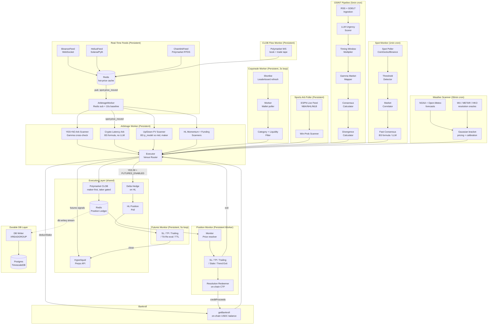

# PolyHype Bot

Autonomous multi-strategy trading agent for Polymarket prediction markets and Hyperliquid perpetual futures. Combines OSINT pipelines, whale wallet mirroring, real-time spot price arbitrage, crypto latency arbitrage, Up/Down fair-value scalping, sports in-play arbitrage, CME settlement arb, longshot bias exploitation, multi-source weather arb, cross-market correlation arb, maker rebate farming, Hyperliquid momentum/funding strategies, and continuous self-improvement (outcome tracking, shadow observations, calibration) into a single risk-managed system.

---

## Architecture Overview

The system runs as **15 Docker Compose services** — nine persistent workers, two 24-hour loop containers, two run-once init containers, and two infrastructure services (Redis, Postgres/TimescaleDB) — plus host-level cron jobs for periodic pipelines. All signals route through a shared execution layer with a continuous improvement feedback loop.



---

## Deployment

Everything runs via **Docker Compose** on a Hetzner CAX11 ARM box. No PM2.

```bash
# Deploy / redeploy
scripts/deploy.sh pga-futures
scripts/deploy.sh pga-arb pga-spot-feed
scripts/deploy.sh --all   # only for intentional full-stack deploys

# Verify
docker compose ps
redis-cli KEYS '*lock*'   # should be empty or only active worker locks
```

Periodic pipelines run via host crontab (not Docker). See [Crontab](#crontab-host-level) below.

---

## Services (Docker Compose)

| Container | Command | Type | Purpose |
|-----------|---------|------|---------|
| **redis** | `redis-server --appendonly yes` | Infrastructure | Central state store |
| **pga-bootstrap** | Stale-lock cleanup | Init (run-once) | Clears stale `lock:*` keys before workers start |
| **pga-spot-feed** | `src/spot/feeds/manager.ts` | Persistent worker | Binance WS + Helius/Pyth + Chainlink RTDS feeds → Redis hot-price cache → publish `spot:price_moved` |
| **pga-arb** | `src/arb/worker.ts` | Persistent worker | YES+NO arb sweep (10s baseline), crypto latency arb, Up/Down FV scanner, HL momentum + funding scanners |
| **pga-copytrade** | `src/copytrade/worker.ts` | Persistent worker † | Mirror expert whale wallets with category/liquidity/slippage guardrails (2s poll loop) |
| **pga-monitor** | `src/monitor/worker.ts` | Persistent worker | PM position monitoring: SL/TP, trailing stop, stale exit, trend exit, divergence close, weather near-res exit, on-chain resolution redemption |
| **pga-futures** | `src/monitor/futuresMonitor.ts` | Persistent worker | HL perp monitoring: SL/TP, trailing stop, max-hold, TA re-eval, funding exits (5s poll) |
| **pga-telegram** | `src/ingestion/telegramMonitor.ts` | Persistent worker † | MTProto listener for OSINT channels → immediate scoring → execution |
| **pga-clob-flow** | `src/clob/flowMonitor.ts` | Persistent worker † | Streams Polymarket book/trade tape into Redis |
| **pga-sports** | `src/sports/poller.ts` | Persistent worker † | NBA/NHL/MLB in-play win-probability edge vs Polymarket |
| **pga-db** | TimescaleDB (pg16) | Infrastructure | Durable analytics database (TimescaleDB + pgvector) |
| **pga-db-migrate** | `node-pg-migrate up` | Init (run-once) | Applies schema migrations on deploy |
| **pga-db-writer** | `src/db/writer/index.ts` | Persistent worker | XREADGROUP consumer draining `db:writeq` Redis stream into Postgres |
| **pga-cron** | `embedTradeMemory` + `snapshotTelemetry` + `weatherReconciler` | Persistent (24h loop) | Nightly analytics: trade memory embeddings, telemetry snapshots, weather outcome reconciliation |
| **pga-db-backup** | `pg_dump` | Persistent (24h loop) | Nightly compressed Postgres backup with 7-day retention |

† Gated behind the `off-scope` Compose profile (current focus: weather + Hyperliquid). A plain `docker compose up -d` starts 11 of the 15 services; add `--profile off-scope` to also start `pga-telegram`, `pga-copytrade`, `pga-clob-flow`, and `pga-sports`.

## Crontab (host-level)

| Schedule | Job | Log |
|----------|-----|-----|
| `*/5 * * * *` | OSINT trade pipeline (`src/execution/index.ts`) | `~/logs/pga/trade.log` |
| `* * * * *` | Spot price monitor (`src/spot/index.ts`) | `~/logs/pga/spot.log` |
| `*/30 * * * *` | Watchlist refresh (`src/cron/refreshWatchlist.ts`) | `~/logs/pga/watchlist.log` |
| `*/30 * * * *` | Near-zero entry scanner (`src/cron/nearZeroScanner.ts`) | `~/logs/pga/near-zero.log` |
| `15 * * * *` | Near-zero OSINT injector (`src/cron/nearZeroOsintInjector.ts`) | `~/logs/pga/nz-injector.log` |
| `* * * * *` | Settlement arb scanner (`src/cron/settlement.ts`) | `~/logs/pga/settlement.log` |
| `0 */2 * * *` | Longshot bias scanner (`src/cron/longshotScanner.ts`) | `~/logs/pga/longshot.log` |
| `*/30 * * * *` | Weather scanner (`src/weather/weatherScanner.ts`) | `~/logs/pga/weather.log` |
| `*/5 * * * *` | Rebate farmer (`src/cron/rebateFarmer.ts`) | `~/logs/pga/rebate.log` |
| `*/30 * * * *` | Residual sweep (`scripts/sweep-residuals.ts --execute`) | `~/logs/pga/sweep-residuals.log` |
| `0 */2 * * *` | Copytrade shortlist refresh (`src/copytrade/shortlist.ts`) | `~/logs/pga/copytrade-shortlist.log` |
| `15 */6 * * *` | Correlation discovery (`src/cron/correlationDiscovery.ts`) | `~/logs/pga/correlation.log` |
| `*/15 * * * *` | Correlation violation scanner (`src/cron/correlationScanner.ts`) | `~/logs/pga/correlation.log` |
| `*/15 * * * *` | PM-activity reconciler (`src/cron/polymarketActivityReconciler.ts`, exec'd inside `pga-cron`) | `~/logs/pga/pm-reconciler.log` |
| `*/15 * * * *` | Heartbeat watchdog (`src/cron/heartbeatWatchdog.ts`, exec'd inside `pga-cron`) | `~/logs/pga/heartbeat.log` |
| `45 * * * *` | Shadow digest (`scripts/shadow-digest.sh`) | `/tmp/shadow-digest.log` |
| `0 3 * * MON` | Calibration stats (`src/cron/calibrate.ts`) | `~/logs/pga/calibrate.log` |
| `0 4 * * *` | Log rotation (`scripts/rotate-logs.sh`) | — |

---

## Data Flow Details

### 1. OSINT Pipeline (`cron:trade`)

```
RSS feeds + GDELT
  → LLM urgency scorer (per-category prompts, score 1–10)
  → Timing window multiplier (×1.20 Asia, ×1.15 EU/ME windows)
  → Gamma API market search (entity extraction + keyword match)
  → Multi-provider LLM consensus probability estimate
  → Half-Kelly divergence sizing
  → Execution Router
```

Seven ingestion categories run in parallel per tick:

| Category | ID | Score Threshold |
|---|---|---|
| Geopolitical | `geopolitical` | 6 |
| Macro / Central Bank | `macro` | 6 |
| Crypto / Regulatory | `crypto-regulatory` | 6 |
| Crypto Futures | `crypto-futures` | 6 |
| AI / Tech | `ai-tech` | 5 |
| Sports | `sports` | 5 |
| US Politics | `us-politics` | 5 |

Timing window boosts are applied after LLM scoring and are capped at 10:

| UTC Window | Region | Multiplier |
|---|---|---|
| 00:00 – 08:00 | Asia/Pacific | ×1.20 |
| 06:00 – 14:00 | Europe/Middle East | ×1.15 |
| Outside windows | — | ×1.00 |

**LLM consensus** (`src/mapping/consensusCalculator.ts`): four providers supported — OpenAI, Gemini, Anthropic, DeepSeek — each configured provider gets **one vote** per estimate (no duplicate sampling of a single model). `CONSENSUS_TARGET_SAMPLES` (default 3, min `CONSENSUS_MIN_SAMPLES=2`) controls how many votes are collected. A per-provider circuit breaker (`consensusBreaker.ts`) skips providers that failed recently, and a consensus cache (default TTL 30 min) dedupes repeat estimates.

### 2. Copytrade Worker (`worker:copytrade`)

```
Polymarket leaderboard API (shortlist refresh every 2h)
  → COPYTRADE_WALLETS list
  → 2s poll loop: fetch recent trades per wallet
  → Category keyword filter (geopolitics, crypto, macro, etc.)
  → Minimum payout ratio gate (COPYTRADE_MIN_PAYOUT_RATIO)
  → Minimum edge magnitude gate (COPYTRADE_MIN_EDGE_MAGNITUDE)
  → Liquidity / slippage / time-to-resolve guards
  → Stake scaling (COPYTRADE_SIZE_SCALE × observed whale size, capped at COPYTRADE_MAX_STAKE_USD)
  → Execution Router
```

Shortlist auto-refresh queries the leaderboard by PnL/volume thresholds and optionally updates `.env` automatically (`COPYTRADE_SHORTLIST_AUTO_APPLY=true`).

### 3. Spot → Arb Path (`worker:spot-feed` + `worker:arb`)

```
BinanceFeed (WebSocket) — live symbol set configured via BINANCE_SYMBOLS
                          (config default: BTC, ETH, SOL)
HeliusFeed (Helius/Pyth) — SOL, BTC, ETH
ChainlinkFeed (Polymarket RTDS WS) — the oracle Polymarket's Up/Down markets resolve against
  → Redis hot-price cache (per-symbol)
  → Publish `spot:price_moved` event

ArbitrageWorker — independent scan paths (ACTIVE_ARB_SCANNERS selects the set):

  Path A — YES+NO combined arbitrage (baseline + fast-path):
    Fast-path: spot:price_moved → immediate sweep trigger
    Baseline:  10s interval sweep (catches moves missed between events)
    → Scan active markets: yesAsk + noAsk < $1.00 - fees
    → Execute both legs sequentially FOK (YES first, NO only if YES fills)

  Path B — Crypto latency arbitrage (fast-path only):
    spot:price_moved → map symbol to correlated PM price-target markets
    → Compute fair value: Black-Scholes binary formula (<1ms, no LLM)
    → edge = |fairValue - pmPrice| - fees
    → If edge > CRYPTO_ARB_MIN_EDGE: execute directional trade
    → 3-min dedup per (marketId, direction) (CRYPTO_ARB_DEDUP_TTL_S, default 180s)

  Path C — 15-minute BTC/ETH Up/Down markets:
    fv-scanner (preferred): BS p_model (src/pricing) vs market mid → maker-post entries
    oracle-lag (legacy):    Chainlink tick vs stale market price → taker entries
    Sigma from realized-vol calibrator (Chainlink ticks, rolling + EWMA estimators)

  Path D — Hyperliquid scanners (both dark by default):
    hl-momentum: multi-timeframe trend score (VWAP/EMA/MACD/OBV/CMF/ADX voters
                 + HL funding-contra and OI-divergence voters), SHORT-biased
    hl-funding:  extreme funding-rate mean reversion (SHORT crowded longs, LONG negative funding)

  Also: negRisk multi-outcome arb scanner (NEGRISK_ARB_ENABLED=false)
  Shared: Unified Global Governor (Redis-backed, shared Polymarket rate limits across all processes)
  → Execution Router
```

### 4. Spot Monitor (`cron:spot`)

```
Spot Poller (CoinGecko REST, configurable assets + lookback window)
  → Threshold Detector (% move OR z-score trigger, per-asset cooldown via Redis)
  → Market Correlator (Gamma search + LLM correlation direction, cached 24h)
  → Fast Consensus Estimator:
      price-target markets → Black-Scholes binary formula (<1ms, no API)
      event markets       → LLM ensemble (same as OSINT pipeline)
  → Divergence Calculator → Execution Router
```

### 5. Sports Arb Poller (`pga-sports`)

```
ESPN live scoreboard feed (NBA / NHL / MLB — SPORTS_LEAGUES, default nba)
  → Win-probability models (closed-form; NBA + NHL + MLB, MLB min-inning gate)
  → Compare vs Polymarket odds
  → Edge detection → Execution Router
```

### 6. Near-Zero Entry Scanner (`cron:nearZeroScanner`)

```
Active Polymarket markets with prices near zero (<5¢)
  → Multi-outcome gate + heuristic regex filter
  → OSINT prioritization (recent headlines for the market topic)
  → Near-zero-specific LLM consensus prompt
  → Direction-aware edge calculation
  → Velocity dead-horse filter (blocks markets trending toward zero)
  → Execution Router
```

### 7. Settlement Arb Scanner (`cron:settlement`)

```
CME commodity futures (Yahoo: GC=F, SI=F, CL=F, ES=F, NQ=F)
  → Match Polymarket binary markets by keyword ("Gold above $X on date?")
  → Extract strike price from question text
  → Compute implied probability: sigmoid((spot - cutoff) / smoothing_band)
  → Compare implied vs market price → edge detection
  → Fires in the ~5min window before CME settlement print
  → Execution Router
```

Designed for the moment when the front-month future is the best proxy for settlement outcome. Currently log-only (`SETTLEMENT_ARB_ENABLED=false`).

### 8. Longshot Bias Scanner (`cron:longshotScanner`)

```
Active Polymarket markets with YES price 3-15¢
  → Category-specific optimism gap (entertainment ~5pp, sports ~2pp, political ~3pp)
  → Exempt well-calibrated domains (crypto, macro)
  → Spread gate: NO price within 5¢ of expected complement (tight books only)
  → Buy NO (bet against retail optimism)
  → Execution Router
```

Exploits the favorite-longshot bias from Whelan's study of 300K contracts: cheap YES is systematically overpriced by retail. The opposite strategy to the near-zero scanner.

### 9. Weather Scanner (`src/weather/weatherScanner.ts`)

Daily highest-temperature (and optionally lowest-temperature) bracket markets across ~50 configured cities worldwide (all shadow-tracked; a subset is excluded from live execution via `WEATHER_EXCLUDED_CITIES` while bias windows accumulate).

```
Gamma API search for weather bracket markets
  → Parse city, date, bracket from question text
  → Forecasts: NOAA/NWS (US cities) + Open-Meteo (international; GFS 31-member
    ensemble drives dynamic σ; optional HRRR/ECMWF, shadow-only)
  → Resolution oracles routed per city: Weather Underground for nearly all
    cities, with per-city exceptions — METAR/aviationweather (Tel Aviv,
    Istanbul, Moscow) and HKO (Hong Kong)
  → Gaussian bracket pricing (forecast mean + σ) + climatology tables
  → Calibration: offline-fit reliability map (bracketCalibration.ts) layered
    over a per-category bias theta (CALIBRATION_BIAS_THETA_WEATHER=0.69)
  → Entry gates: modal-mass veto, market-favorite-NO veto, near-res entry,
    optional res-day-only / timing-gate / live-confirmation modes
  → Maker-first order lifecycle (makerLifecycle.ts) with optional taker entries
  → Execution Router
```

Position management (in `pga-monitor` + scanner passes):
- **Drift exits** — model/market drift against a held position (dead-bid and modal handling included)
- **Invalidation** — forecast no longer supports the thesis: blocks size-ups, optional cheap hedge
- **Res-day lock-in** — buys the cheap opposite bracket once the outcome is effectively decided
- **Flip exits** — confirmed / market-oracle / forecast flip classes
- **Near-resolution exit** — routes winners to on-chain redemption instead of selling into a thin book

Every scan writes a row to `shadow_observations` (the SSOT for strategy analysis) whether or not a trade fires; `weatherReconciler.ts` fills in realized outcomes nightly and `scripts/shadow-digest.sh` posts an hourly digest. Master switches (`WEATHER_SCANNER_ENABLED`, `WEATHER_EXECUTION_ENABLED`) default off in code and are driven by `.env`.

### 10. Calibration Bias Adjustment (inline in divergence calculator)

```
LLM consensus probability estimate
  → Look up per-category calibration theta (from weekly recalibration stats)
  → Apply power-law correction: adjusted = P^theta
  → Categories where theta > 1 are overconfident → corrected downward
  → Feeds into Half-Kelly sizing with bias-adjusted probability
```

Not a standalone scanner. Runs inline during every OSINT trade evaluation when `CALIBRATION_BIAS_ENABLED=true`.

### 11. Cross-Market Correlation Arb (`cron:correlationDiscovery` + `cron:correlationScanner`)

```
Discovery (every 6h):
  Cached markets → entity extraction (keyword tokenization)
    → Reverse-index pair finder (shared token overlap, O(N×E))
    → LLM relationship classifier (implication or mutual-exclusion)
    → Persist constraint edges in Redis graph (7-day TTL)

Violation scanner (every 15min):
  Load constraint graph + current market prices
    → Detect violations:
        Implication A→B:      P(A) > P(B) + minEdge → buy B YES
        Mutual exclusion:     P(A)+P(B) > 1+minEdge → buy NO on overpriced side
    → Liquidity filter on both sides
    → Single-leg execution via Execution Router
```

### 12. Rebate Farmer (`cron:rebateFarmer` + `src/rebate/`)

Passive maker liquidity provision on fee-enabled markets. Every ~5 minutes:

```
Reconcile tracked orders (runs even while disabled):
  detect fills → HOLD still-live resting orders (preserves CLOB queue priority)
  → cancel only past resolution / lifetime backstop → sweep orphans
Budget: bankroll × fraction, hard-capped
Market selection: score fee-enabled markets by taker fee-equivalent flow/hour
  (flowAnalyzer + marketSelector), gate ghost books (max spread, mid-vs-VWAP)
Pair planning (pairPlanner, pure): two-sided post-only YES bid + NO bid
  at effective mid − edge (combined ≤ 1 − REBATE_MIN_COMBINED_EDGE)
Execution (orderManager): fresh pairs placed atomically — both legs preflighted,
  governor slots reserved, leg-1 rolled back if leg-2 fails
```

Rebates are paid daily (pUSD, $1 min) from each market's taker-fee pool; resting orders that never fill earn nothing. Accrual is verified against `GET clob.polymarket.com/rebates/current` in a daily summary (`rebateChecker.ts`). Filled orders enter the ledger as `sourcedFrom='rebate-farming'` and hold to resolution (the redeemer is the only exit). Disabled by default (`REBATE_FARMING_ENABLED=false`); `REBATE_SHADOW_MODE` runs the full pipeline and logs would-place plans.

### 13. Execution Layer (shared)

All signals from every pipeline route through `executor.ts`:

```
Global governor check (Redis-backed shared rate limits, per platform)
Futures routing: signal.isFutures → dedicated idempotency + open-position check
  → Hyperliquid execution (skips all PM gates below)
Stake floor: stakes < 60% of MIN_BET_USD → skip; 60–100% → bumped UP to the floor
Position dedup: canonicalizes UP/YES vs DOWN/NO; opposite side held → skip;
  same side held → size-up evaluation (SIZE_UP_ELIGIBLE_SOURCES) or skip
Idempotency guard: Redis key sha256(marketId:direction:stake), 1h TTL
Closed guard: recently-resolved / stale-cooldown checks

CLOB execution:
  Maker-first for eligible sources (osint, copytrade, near-zero-arb,
    correlation-arb, weather, fv-scanner) — post-only with lifecycle management
  Taker path gated by canExecuteTaker (edge-vs-category thresholds, tail-price block)

Post-trade:
  - deductStake from bankroll cache
  - recordPosition in Redis ledger (or sizeUpPosition)
  - Emit to db:writeq stream → Postgres (execution_events, maker_telemetry, …)
  - If YES buy + FUTURES_ENABLED: open delta hedge on Hyperliquid
  - Telegram notification
```

**Execution venues:**

| Venue | When used | Auth |
|---|---|---|
| **Polymarket CLOB** | All prediction-market signals | `POLYGON_WALLET_PRIVATE_KEY` |
| **Hyperliquid** | Futures signals + delta hedging | `HYPERLIQUID_PRIVATE_KEY` |

CLOB signature modes:

| Type | Account | `POLYMARKET_FUNDER_ADDRESS` |
|---|---|---|
| `0` EOA | MetaMask / hardware wallet | Not required |
| `1` POLY_PROXY | Magic / Google OAuth wallet | Required |
| `2` POLY_GNOSIS_SAFE | Gnosis Safe multisig | Required |

### 14. Hyperliquid Futures & Delta Hedging

Futures signals come from two places: the HL scanners in the arb worker (momentum, funding — see Path D above) and delta hedges opened after Polymarket fills on price-correlated markets. Hedge direction is question-aware: bullish questions ("above $X?") hedge with a SHORT; bearish questions ("below $X?") hedge with a LONG, so the net delta is always neutral regardless of which PM side was bought.

- **Delta hedge**: 1:1 opposing perp at entry, sized to match PM stake. Exempt from the max-hold timer and TA-fade exits — closes only when the linked PM market resolves.
- **Synthetic exit**: If PM liquidity is too thin to exit, `takeProfitExecutor` opens an equal-and-opposite HL position to freeze P&L. PM side stays in the ledger until on-chain resolution.
- **Risk limits**: Global margin cap (`FUTURES_GLOBAL_MAX_MARGIN_USD`) and per-trade cap (`FUTURES_MAX_PER_TRADE_USD`).
- **Urgency gating**: Futures signals from news (OSINT) only fire above `FUTURES_URGENCY_THRESHOLD`.
- **Confluence gate**: Pre-entry TA gate (trend-scorer voters + ADX/Choppiness) blocks trades below `FUTURES_MIN_CONFLUENCE_SCORE`.

**Futures Monitor** (`pga-futures`, 5s poll):
- Fixed SL/TP ROE thresholds (defaults −7.5% / +15%; per-source overrides for hl-momentum and hl-funding)
- **ROE backstop** (`FUTURES_MAX_LOSS_ROE_PCT`): leverage-invariant hard stop (0 = disabled)
- **Trailing stop** (`FUTURES_TRAILING_STOP_ENABLED=true`): arms at TP line, ratchets floor with HWM, exits on giveback from peak
- **ATR-based SL/TP** (`FUTURES_ATR_SLTP_ENABLED=false`): derives thresholds from entry-time ATR snapshot — shadow-logged, reverted from live after inverting payoff geometry
- **TA re-evaluation** (`FUTURES_EXIT_ON_SIGNAL_FADE=true`): periodic confluence re-check (exit at 5/7 against), contrarian + hedge positions exempt
- **Funding exits** (hl-funding source): exits when |APR| normalises or funding flips sign
- **Native exchange-side stops** (`HL_NATIVE_STOP_ENABLED=false`): optional resting trigger orders on HL
- **Max hold** 4h — blocked while position is a loser (`block_on_loser`); not applied to active hedges
- **Cooldowns**: per-symbol post-loss cooldown (configurable), per-side post-TP momentum cooldown
- Heartbeat logging for health monitoring

### 15. Position Monitor (`pga-monitor`, persistent worker)

```
Redis position ledger → all open PM positions
  → Price resolution:
      1. CLOB WebSocket cache (Redis, 30s TTL) — sub-second freshness
      2. Gamma REST fallback
  → Near-resolution gate: price ≥ MONITOR_NEAR_RES_PRICE_THRESHOLD →
      route to redeemer (suppresses TP/trailing — winners redeem at $1, not sell at 0.97)
  → Evaluators (per position):
      Stop-loss (tiered per category; zone-aware bands via ZONE_AWARE_SL_ENABLED) → exit
      Take-profit (tiered, same categories)                                      → exit
      Trailing stop (suppresses fixed TP, ratchets floor with HWM)               → exit
      Stale exit (age + peak-decline based, per-category timers)                 → exit
      Trend exit (OLS regression on price samples, R² gated)                     → exit
      Divergence closed (market reached consensus)                               → exit
      Weather near-res exit (weather positions on resolution day)               → redeem
  → Signal re-eval (LLM edge check vs fresh headlines) runs from the OSINT cron
  → Maker exit (post-only limit order with taker fallback)
  → Resolution Redeemer:
      On-chain CTF redemption (ProxyWalletFactory / CLOB client)
      Handles auto-redeemed wins, dust positions, sibling-side-resolved closes
      → credit bankroll
```

**Take-profit tiers:**

| Category | TP Threshold | SL Threshold |
|---|---|---|
| General (OSINT) | `TAKE_PROFIT_THRESHOLD` | `STOP_LOSS_THRESHOLD` |
| Crypto | `CRYPTO_TAKE_PROFIT` | `CRYPTO_STOP_LOSS` |
| Short-duration | `SHORT_DURATION_TAKE_PROFIT` | `SHORT_DURATION_STOP_LOSS` |
| Copytrade | `COPYTRADE_TAKE_PROFIT` | `COPYTRADE_STOP_LOSS` |

All tiers share the same trailing stop mechanism (`TRAILING_STOP_ENABLED`, `TRAILING_GIVEBACK_PCT`). Trailing activation = the tier's TP threshold.

### 16. Durable DB Layer

Analytics data flows from workers to Postgres via a Redis stream:

```
Workers → enqueueWrite('table', payload) → Redis stream db:writeq
  → pga-db-writer (XREADGROUP consumer) → Postgres/TimescaleDB
```

- Analytics tables wired to emit sites (`execution_events`, `shadow_observations`, `maker_telemetry`, `signal_decisions`, `hedge_events`, …)
- TimescaleDB for time-series queries, pgvector for trade memory embeddings
- `shadow_observations` is the single source of truth for strategy backtests
- Nightly crons: trade memory embedding, telemetry snapshots, weather reconciliation
- Nightly pg_dump backup with 7-day retention

### 17. Bankroll

`bankroll.ts` maintains an in-process cache of the wallet's **on-chain USDC (pUSD) balance** on Polygon (15s TTL):

- `getBankroll()` — ERC-20 `balanceOf` on the trading wallet (funder address for POLY_PROXY, derived EOA otherwise), multi-RPC fallback with per-RPC timeout, degrades to last-known balance on failure
- `deductStake()` — immediately adjusts the cache after a trade so consecutive signals in the same cycle size correctly
- `creditProceeds()` — credits exit/redemption proceeds back to the cache

---

## Overlap Protection

| Layer | Applies to | Mechanism |
|---|---|---|
| `flock` in `run.sh` | All cron pipelines | OS file lock per script — blocks second cron tick if prior OS process still running |
| Redis overlap lock | `cron:trade`, `cron:spot`, workers | Token-based `SET NX EX` + Lua compare-and-delete release — safe across long LLM cycles |
| Distributed lock | `pga-monitor`, `pga-futures`, `pga-copytrade`, `pga-arb` | Hostname-based stale detection + tri-state refresh (refreshed/expired/stolen) |
| `ARB_ENABLED` flag | `worker:arb` | Exits immediately if disabled |

---

## Module Reference

| Module | Description |
|---|---|
| `src/ingestion/` | RSS + GDELT scraping, Telegram MTProto monitor, Redis dedup, LLM urgency scoring, timing window, category classifier |
| `src/ingestion/categories/` | `CategoryConfig` registry — per-category feeds, scorer prompts, thresholds (7 categories) |
| `src/mapping/` | Gamma API client, entity extraction, multi-provider consensus probability, Half-Kelly sizing, divergence |
| `src/spot/` | Spot poller, threshold detector (% + z-score), market correlator, fast consensus estimator |
| `src/spot/feeds/` | BinanceFeed (WebSocket), HeliusFeed (Helius/Pyth), ChainlinkFeed (Polymarket RTDS), FeedManager |
| `src/arb/` | ArbitrageWorker (pub/sub + baseline), YES+NO arb, crypto latency arb, Up/Down FV + oracle-lag scanners, negRisk scanner, confluence scorer, candle aggregator |
| `src/futures/` | Hyperliquid strategy scanners: momentum (MTF trend voters), funding mean-reversion, breakout-retest helper, trend scorer, decision sampling |
| `src/pricing/` | Black-Scholes binary pricer for Up/Down markets, realized-vol sigma calibrator (rolling + EWMA from Chainlink ticks) |
| `src/rebate/` | Maker rebate farming: flow analyzer, market selector, pair planner, atomic order manager, rebates-API checker |
| `src/copytrade/` | Whale wallet worker, leaderboard shortlist refresh, payout ratio + edge magnitude gates |
| `src/sports/` | ESPN live feed (NBA/NHL/MLB), win-probability models, sports arb poller |
| `src/clob/` | CLOB flow monitor — streams Polymarket book/trade tape into Redis |
| `src/cron/` | Scheduled jobs: OSINT pipeline, near-zero scanner, longshot scanner, settlement arb, correlation discovery + scanner, rebate farmer, watchlist refresh, calibration, heartbeat watchdog |
| `src/correlation/` | Cross-market correlation arb: entity extractor, pair finder, LLM relationship classifier, constraint graph (Redis), violation detector |
| `src/weather/` | Weather bracket pipeline: NOAA/Open-Meteo forecast clients, WU/METAR/HKO resolution oracles, Gaussian bracket pricing, reliability-map calibration, drift/invalidation/lock-in/flip exits, maker lifecycle, reconciler, digest |
| `src/settlement/` | CME settlement arb: commodity keyword matching, strike extraction, sigmoid implied probability |
| `src/execution/` | Executor (venue router, gates, maker-first CLOB execution, maker exit), position ledger, Telegram notifications |
| `src/monitor/` | Position monitor worker, price resolver (WS + REST), tiered SL/TP, trailing stop, stale exit, trend exit, weather near-res exit, on-chain resolution redeemer, futures monitor |
| `src/db/` | Write queue (Redis stream producer), DB writer (XREADGROUP consumer), migrations, retrieval layer |
| `src/shared/` | Redis singleton (tri-state lock refresh), config (Zod — source of truth for all env defaults), bankroll, logger, governor, ledger, outcome recorder, calibration, assets |
| `src/shared/hyperliquid.ts` | Hyperliquid perps client — order placement, position queries, mid-price cache |
| `src/shared/clob.ts` | Polymarket CLOB client — order signing, balance, on-chain redemption |

---

## Setup

```bash
# 1. Configure environment
cp .env.example .env
# Fill in required values (see .env.example for full docs)

# 2. Create Postgres password secret
mkdir -p secrets
echo 'your-pg-password' > secrets/pg_password

# 3. Deploy
docker compose up -d --build
# add --profile off-scope to also start pga-telegram, pga-copytrade,
# pga-clob-flow, and pga-sports (disabled by default — see Services table)

# 4. Verify
docker compose ps             # all started services Up/Healthy
redis-cli KEYS '*lock*'       # no stale locks

# 5. Set up host crontab (see Crontab section above)
crontab -e

# 6. Initialize copytrade shortlist
npm run cron:shortlist
```

---

## Scripts

| Script | Description |
|---|---|
| `npm run build` | TypeScript type-check (no emit) |
| `npm run lint` | ESLint |
| `npm run format` | Prettier |
| `npm test` | Vitest test suite |
| `npm run probe:clob-allowance` | Verify CLOB USDC allowance |
| `npm run cron:trade` | Run OSINT pipeline once (ingest + map + execute) |
| `npm run cron:monitor` | Run position monitor once |
| `npm run cron:spot` | Run spot monitor once |
| `npm run cron:rebate` | Run rebate farmer once |
| `npm run worker:copytrade` | Start persistent copytrade worker |
| `npm run worker:arb` | Start persistent arbitrage worker |
| `npm run worker:spot-feed` | Start persistent spot price feeds |
| `npm run monitor:futures` | Start persistent Hyperliquid futures monitor |
| `npm run worker:telegram` | Start persistent Telegram MTProto monitor |
| `npm run cron:shortlist` | Refresh copytrade wallet shortlist from leaderboard |
| `npm run cron:calibrate` | Recompute calibration stats per category (weekly) |
| `npm run cron:watchlist` | Refresh dynamic watchlist from active markets |
| `npm run sync-env` | Append missing keys from `.env.example` to `.env` |
| `npx tsx scripts/reconcile-futures-ledger.ts` | Compare Redis futures ledger vs live Hyperliquid positions |
| `scripts/deploy.sh` | Pull from main, deploy named services by default, `--all` for full stack, prune images |
| `scripts/diagnose.sh` | System health diagnostic |
| `scripts/monitor-dashboard.sh` | tmux-based log dashboard |
| `scripts/shadow-digest.sh` | Hourly shadow-observation digest to Telegram |
| `scripts/rotate-logs.sh` | Rotate logs > 5MB (keeps 1 backup) |

---

## Key Environment Variables

Config defaults live in `src/shared/config.ts` (Zod schema — the source of truth); `.env.example` documents them; runtime values live in `.env` (gitignored). Highlights:

| Variable | Required | Description |
|---|---|---|
| `REDIS_URL` | Yes | Redis connection string |
| `POLYGON_WALLET_PRIVATE_KEY` | Yes | CLOB order signing + on-chain bankroll/redemption |
| `POLYMARKET_SIGNATURE_TYPE` / `POLYMARKET_FUNDER_ADDRESS` | Per wallet type | See CLOB signature modes above |
| `OPENAI_API_KEY` / `GEMINI_API_KEY` / `ANTHROPIC_API_KEY` / `DEEPSEEK_API_KEY` | Yes (≥1) | LLM providers for scoring/mapping/consensus (one vote each) |
| `TELEGRAM_BOT_TOKEN` + `TELEGRAM_CHAT_ID` | Yes | Trade notifications |
| `HYPERLIQUID_PRIVATE_KEY` | For futures | HL order signing |
| `MIN_BET_USD` | — | Stake floor (default 5); stakes ≥60% of floor are bumped up to it |
| `FUTURES_ENABLED` | — | Master switch for delta hedging + futures monitor |
| `COPYTRADE_ENABLED` | — | Master switch for copytrade worker |
| `ARB_ENABLED` / `ACTIVE_ARB_SCANNERS` | — | Arb worker master switch + scanner set |
| `CRYPTO_ARB_ENABLED` | — | Crypto latency arb path |
| `HL_MOMENTUM_ENABLED` / `HL_FUNDING_SCANNER_ENABLED` | — | Hyperliquid strategy scanners (default off) |
| `SPOT_MONITOR_ENABLED` | — | Master switch for spot monitor |
| `TRAILING_STOP_ENABLED` | — | PM trailing stop (activation = TP threshold) |
| `STALE_EXIT_ENABLED` / `TREND_EXIT_ENABLED` | — | Stuck-position and trend-reversal exits |
| `MAKER_EXIT_ENABLED` | — | Post-only limit order exits with taker fallback |
| `NEAR_ZERO_SCANNER_ENABLED` | — | Near-zero market entry scanner |
| `LONGSHOT_SCANNER_ENABLED` | — | Longshot bias NO-side scanner |
| `WEATHER_SCANNER_ENABLED` / `WEATHER_EXECUTION_ENABLED` | — | Weather arb scanner + execution (default off) |
| `SETTLEMENT_ARB_ENABLED` | — | CME settlement arb scanner |
| `CORRELATION_SCANNER_ENABLED` | — | Cross-market correlation arb scanner |
| `REBATE_FARMING_ENABLED` / `REBATE_SHADOW_MODE` | — | Maker rebate farming (default off / shadow) |
| `SPORTS_ARB_ENABLED` / `SPORTS_LEAGUES` | — | Sports in-play arb (default `nba`) |
| `CALIBRATION_ENABLED` / `CALIBRATION_BIAS_ENABLED` | — | Calibration correction + per-category bias adjustment |

---

## Phases

See [docs/PHASES.md](docs/PHASES.md) and [docs/PRD.md](docs/PRD.md).
