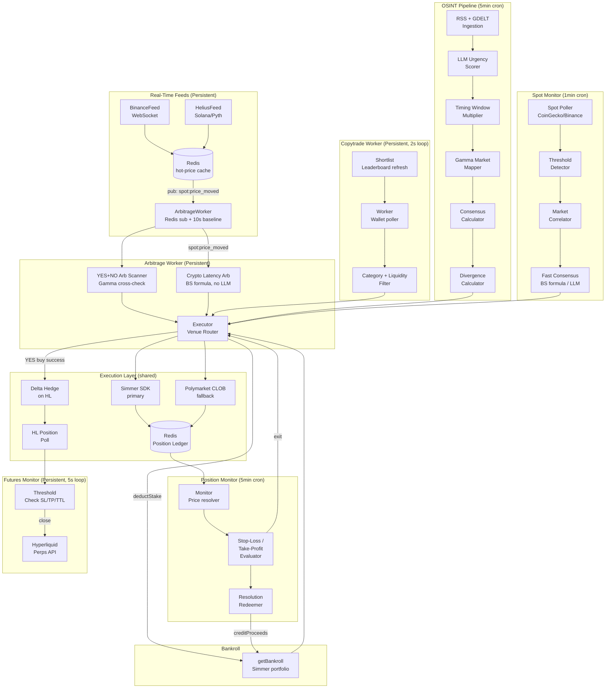

# Polymarket Geopolitical Trading Agent

Autonomous multi-signal trading agent for Polymarket prediction markets. Combines OSINT pipelines, whale wallet mirroring, real-time spot price arbitrage, crypto latency arbitrage, Hyperliquid futures hedging, and continuous self-improvement (outcome tracking, context injection, calibration) into a single risk-managed system.

---

## Architecture Overview

The system runs as **seven concurrent processes** — two persistent workers plus five periodic pipelines — each independently signalling trades through a shared execution layer, with a continuous improvement feedback loop that records outcomes, injects historical context into LLM prompts, and applies calibration corrections.



---

## Processes

| Process | Script | Interval | Purpose |
|---------|--------|----------|---------|
| **Spot Feed Worker** | `worker:spot-feed` | Persistent | Binance WS + Helius Solana feeds → Redis hot-price cache → publish `spot:price_moved` |
| **Arbitrage Worker** | `worker:arb` | Persistent (sub + 10s) | Two arb paths: (1) YES+NO combined < $1 sweep on 10s baseline; (2) crypto latency arb on every `spot:price_moved` event — BS fair value vs stale PM price, no LLM, sub-500ms |
| **Copytrade Worker** | `worker:copytrade` | Persistent (2s loop) | Mirror expert whale wallets with category/liquidity/slippage guardrails |
| **Futures Monitor** | `monitor:futures` | Persistent (5s poll) | HL perp SL/TP/max-hold enforcement for delta hedges and synthetic exits |
| **Telegram Monitor** | `worker:telegram` | Persistent | MTProto listener for `dbot_alerts` / `osint_intel` → immediate scoring → execution |
| **OSINT Pipeline** | `cron:trade` | 5 min | RSS + GDELT ingest → LLM score → Gamma mapping → divergence → execute |
| **Position Monitor** | `cron:monitor` | 5 min | PM price resolution → SL/TP/divergence exits → auto-redeem resolved positions |
| **Spot Monitor** | `cron:spot` | 1 min | Spot price move detection → correlated Polymarket market search → fast consensus → execute |
| **Watchlist Refresh** | `cron:watchlist` | 4 hours | Syncs active Polymarket market keywords with Redis for the Dynamic Watchlist gate |

---

## Data Flow Details

### 1. OSINT Pipeline (`cron:trade`)

```
RSS feeds + GDELT
  → LLM urgency scorer (per-category prompts, score 1–10)
  → Timing window multiplier (×1.20 Asia, ×1.15 EU/ME windows)
  → Gamma API market search (entity extraction + keyword match)
  → Multi-sample LLM consensus probability estimate
  → Half-Kelly divergence sizing
  → Execution Router
```

Five ingestion categories run in parallel per tick:

| Category | ID | Score Threshold |
|---|---|---|
| Geopolitical | `geopolitical` | 8 |
| Macro / Central Bank | `macro` | 8 |
| Crypto / Regulatory | `crypto-regulatory` | 8 |
| AI / Tech | `ai-tech` | 7 |
| US Politics | `us-politics` | 7 |

Timing window boosts are applied after LLM scoring and are capped at 10:

| UTC Window | Region | Multiplier |
|---|---|---|
| 00:00 – 08:00 | Asia/Pacific | ×1.20 |
| 06:00 – 14:00 | Europe/Middle East | ×1.15 |
| Outside windows | — | ×1.00 |

### 2. Copytrade Worker (`worker:copytrade`)

```
Polymarket leaderboard API (weekly shortlist refresh)
  → COPYTRADE_WALLETS list
  → 2s poll loop: fetch recent trades per wallet
  → Category keyword filter (geopolitics, crypto, macro, etc.)
  → Liquidity / slippage / time-to-resolve guards
  → Stake scaling (COPYTRADE_SIZE_SCALE × observed whale size, capped at COPYTRADE_MAX_STAKE_USD)
  → Execution Router
```

Shortlist auto-refresh queries the leaderboard by PnL/volume thresholds and optionally updates `.env` automatically (`COPYTRADE_SHORTLIST_AUTO_APPLY=true`).

### 3. Spot → Arb Path (`worker:spot-feed` + `worker:arb`)

```
BinanceFeed (WebSocket) — assets: BTC, ETH, SOL, XRP, BNB, TAO, DOGE, ADA, AVAX, LINK, SUI
HeliusFeed (Helius/Pyth) — SOL price
  → Redis hot-price cache (per-symbol)
  → Publish `spot:price_moved` event

ArbitrageWorker — two independent arb paths run on every event:

  Path A — YES+NO combined arbitrage (baseline + fast-path):
    Fast-path: spot:price_moved → immediate sweep trigger
    Baseline:  10s interval sweep (catches moves missed between events)
    → Scan 1,000 active markets: yesAsk + noAsk < $1.00 - fees
    → Execute both legs sequentially (YES first, NO only if YES fills)

  Path B — Crypto latency arbitrage (fast-path only, Phase 7):
    spot:price_moved → map symbol to asset → find correlated PM price-target markets
    → Redis market cache (1h TTL, fallback to Gamma search)
    → Fetch current PM price from WS cache (sub-second)
    → Compute fair value: Black-Scholes binary formula (<1ms, no LLM)
    → edge = |fairValue - pmPrice| - fees
    → If edge > CRYPTO_ARB_MIN_EDGE (default 8%): execute directional trade
    → 5-min dedup per (marketId, direction)

  Shared: Unified Global Governor (Redis-backed, shared Polymarket rate limits across all processes)
  → Execution Router
```

**Tracked assets (Path B):**

| Binance symbol | Asset ID | Search terms |
|---|---|---|
| btcusdt | bitcoin | bitcoin, BTC |
| ethusdt | ethereum | ethereum, ETH |
| solusdt | solana | solana, SOL |
| xrpusdt | ripple | XRP, ripple |
| bnbusdt | binancecoin | BNB, binance coin |
| taousdt | bittensor | TAO, bittensor |
| dogeusdt | dogecoin | dogecoin, DOGE |
| adausdt | cardano | cardano, ADA |
| avaxusdt | avalanche | avalanche, AVAX |
| linkusdt | chainlink | chainlink, LINK |
| suiusdt | sui | SUI |

### 4. Spot Monitor (`cron:spot`)

```
Spot Poller (CoinGecko REST, configurable assets + lookback window)
  → Threshold Detector (% move vs rolling window, per-asset cooldown via Redis)
  → Market Correlator (Gamma search + LLM correlation direction, cached 24h)
  → Fast Consensus Estimator:
      price-target markets → Black-Scholes binary formula (<1ms, no API)
      event markets       → LLM ensemble (same as OSINT pipeline)
  → Divergence Calculator → Execution Router
```

### 5. Execution Layer (shared)

All signals from every pipeline route through `executor.ts`:

```
Pre-trade context check (Simmer /context endpoint):
  - Market resolved/closed → skip
  - Already have open position on same side → skip
  - Flip-flop warning → skip
  - Market has fees → skip

Venue routing:
  Primary:  Simmer SDK (managed wallet, simple API)
  Fallback: Polymarket CLOB (local key signing, 3 sig type modes)

Post-trade:
  - Record position in Redis ledger (marketId, venue, direction, entry price, stake, txHash)
  - Deduct stake from in-process bankroll cache
  - If YES buy + FUTURES_ENABLED: open delta hedge on Hyperliquid (1:1 SHORT)
  - Unified rate limit check (Polymarket only; Hyperliquid exempt)
  - Telegram notification
```

**Execution venues:**

| Venue | When used | Auth |
|---|---|---|
| **Simmer** (primary) | Market in Simmer catalogue | `SIMMER_API_KEY` |
| **Polymarket CLOB** (fallback) | Market not in Simmer | `POLYGON_WALLET_PRIVATE_KEY` |
| **Hyperliquid** (hedging) | After Simmer YES fill; HL symbol exists | `HYPERLIQUID_PRIVATE_KEY` |

CLOB signature modes:

| Type | Account | `POLYMARKET_FUNDER_ADDRESS` |
|---|---|---|
| `0` EOA | MetaMask / hardware wallet | Not required |
| `1` POLY_PROXY | Magic / Google OAuth wallet | Required |
| `2` POLY_GNOSIS_SAFE | Gnosis Safe multisig | Required |

### 6. Hyperliquid Futures & Delta Hedging

After a successful Polymarket YES fill, the executor optionally opens an offsetting SHORT on Hyperliquid Perpetuals:

- **Delta hedge**: 1:1 SHORT at entry, sized to match PM stake. Neutralises directional exposure while retaining the geopolitical headline alpha.
- **Synthetic exit**: If PM liquidity is too thin to exit, `takeProfitExecutor` opens an equal-and-opposite HL position to freeze P&L. PM side closes in the Redis ledger; HL side is managed independently by the futures monitor.
- **Latency arb**: ArbitrageWorker detects spot moves on Binance/Helius and front-runs Polymarket order book adjustments via HL perps. The scanner automatically prioritizes markets with correlated HL counterparts for delta-neutral arbitrage.
- **Risk limits**: Global margin cap (`FUTURES_GLOBAL_MAX_MARGIN_USD`, default $200) and per-trade cap (`FUTURES_MAX_PER_TRADE_USD`, default $10).
- **Urgency gating**: Futures signals from news (OSINT) only fire if urgency > `FUTURES_URGENCY_THRESHOLD` (default 6).

**Futures Monitor** (`monitor:futures`, 5s poll):
- Tracks all open HL perp positions
- Enforces `FUTURES_STOP_LOSS_PCT` and `FUTURES_TAKE_PROFIT_PCT` thresholds
- Max hold time enforced (`FUTURES_MAX_HOLD_HOURS`)
- Heartbeat logging (every 2 minutes) for health monitoring
- Executes HL market close + Telegram notification on trigger

### 7. Position Monitor (`cron:monitor`)

```
Redis position ledger → all open positions
  → Price resolution:
      1. CLOB WebSocket cache (Redis, 30s TTL) — sub-second freshness
      2. Gamma REST fallback
  → Evaluators (per position):
      Stop-loss (default 30% down)     → exit
      Take-profit (default 25% up)     → exit
      Signal re-eval (LLM edge check)  → exit if edge < floor
      Divergence closed (market consensus reached) → exit
  → Resolution Redeemer:
      Simmer: check resolved status → POST /redeem (rate-limited, 9/min)
      CLOB: check Gamma API resolution → on-chain redemption → credit bankroll
```

**Exit priority:**

| Priority | Trigger | Where |
|---|---|---|
| 1 | Futures stop-loss ≥ configured % | Futures Monitor |
| 2 | Futures take-profit ≥ configured % | Futures Monitor |
| 3 | Polymarket stop-loss ≥ 30% | Position Monitor |
| 4 | Polymarket take-profit ≥ 25% | Position Monitor |
| 5 | Signal re-eval — edge evaporated | Position Monitor |
| 6 | Divergence closed | Position Monitor |

### 8. Bankroll

`bankroll.ts` maintains an in-process cache of the live Simmer portfolio balance (15s TTL):

- `getBankroll()` — fetches from Simmer portfolio API, uses last-known on fetch failure
- `deductStake()` — immediately adjusts the cache after a trade so consecutive signals in the same cycle size correctly
- `creditProceeds()` — credits CLOB redemption proceeds back (Simmer tracks its own wallet; CLOB proceeds are on-chain)

---

## Overlap Protection

| Layer | Applies to | Mechanism |
|---|---|---|
| `flock` in `run.sh` | All cron pipelines | OS file lock per script — blocks second cron tick if prior OS process still running |
| Redis overlap lock | `cron:trade`, `cron:monitor`, `cron:spot` | Token-based `SET NX EX` + Lua compare-and-delete release — safe across long LLM cycles |
| `ARB_ENABLED` flag | `worker:arb` | Exits immediately if disabled — no lock needed (cycles are short) |
| `WS_ENABLED=false` | All | Disables CLOB WebSocket subscriptions — REST-only mode for test environments |

---

## Module Reference

| Module | Description |
|---|---|
| `src/ingestion/` | RSS + GDELT scraping, Redis dedup, LLM urgency scoring, timing window |
| `src/ingestion/categories/` | `CategoryConfig` registry — per-category feeds, scorer prompts, thresholds |
| `src/mapping/` | Gamma API client, entity extraction, consensus probability, Half-Kelly sizing, divergence |
| `src/spot/` | Spot poller, threshold detector, market correlator, fast consensus estimator |
| `src/spot/feeds/` | BinanceFeed (WebSocket), HeliusFeed (Helius/Pyth), FeedManager |
| `src/arb/` | ArbitrageWorker (pub/sub + baseline), YES+NO arb scanner, crypto latency arb scanner (Phase 7) |
| `src/arb/cryptoArbScanner.ts` | Crypto latency arb — BS fair value computation, asset→market mapping, Redis market cache, dedup |
| `src/copytrade/` | Whale wallet worker, leaderboard shortlist refresh |
| `src/execution/` | Executor (venue router, pre-trade context check), position ledger, Telegram notifications |
| `src/monitor/` | Price resolver (WS + REST), SL/TP/divergence evaluator, resolution redeemer |
| `src/shared/hyperliquid.ts` | Hyperliquid perps client — order placement, position queries, mid-price cache |
| `src/shared/bankroll.ts` | Live bankroll tracker (Simmer portfolio), in-process cache |
| `src/shared/clob.ts` | Polymarket CLOB client — order signing, balance, on-chain redemption |
| `src/shared/simmer.ts` | Simmer SDK wrapper — opportunities, context, portfolio, redeem |
| `src/shared/redis.ts` | Redis client, pub/sub, distributed lock (token-based) |
| `src/shared/outcomeRecorder.ts` | Outcome recorder — records every closed position for context injection and calibration |
| `src/shared/calibration.ts` | Calibration tracker — weekly win-rate analysis, edge correction factors per category |
| `src/cron/calibrate.ts` | Weekly calibration cron entrypoint — recomputes stats, sends Telegram summary |
| `src/shared/feedSingleton.ts` | Shared `ClobPriceFeed` singleton — WS order book subscriptions for watched markets |

---

## Setup

```bash
# 1. Start Redis
docker run -d --name pga-redis --restart unless-stopped -p 6379:6379 redis:alpine

# 2. Install dependencies
npm install

# 3. Configure environment
cp .env.example .env
# Fill in required values (see .env.example for full docs)

# Safely sync new keys from .env.example if upgrading:
npm run sync-env

# 4. Verify build
npm run build

# 5. Probe Simmer connectivity
npm run probe:simmer

# 6. Initialize copytrade shortlist
npm run cron:shortlist
```

### Running with PM2 (recommended)

```bash
# Persistent workers
pm2 start "npm run worker:copytrade"  --name pga-copytrade
pm2 start "npm run worker:arb"        --name pga-arb
pm2 start "npm run worker:spot-feed"  --name pga-spot-feed
pm2 start "npm run monitor:futures"   --name pga-futures
pm2 start "npm run worker:telegram"   --name pga-telegram

# Periodic pipelines (or use the crontab below)
pm2 start "npm run cron:trade"        --name pga-trade   --cron "*/5 * * * *"
pm2 start "npm run cron:monitor"      --name pga-monitor --cron "*/5 * * * *"
pm2 start "npm run cron:spot"         --name pga-spot    --cron "* * * * *"
```

### Crontab (alternative to PM2 for periodic jobs)

```cron
PATH=/usr/local/bin:/usr/bin:/bin

# OSINT pipeline (every 5 min)
*/5 * * * * /path/to/pga/run.sh npx tsx src/execution/index.ts >> ~/logs/pga/trade.log 2>&1

# Position monitor (every 5 min)
*/5 * * * * /path/to/pga/run.sh npx tsx src/monitor/index.ts >> ~/logs/pga/monitor.log 2>&1

# Spot price monitor (every 1 min)
* * * * *   /path/to/pga/run.sh npx tsx src/spot/index.ts >> ~/logs/pga/spot.log 2>&1

# Copytrade shortlist refresh (daily 06:00 GMT)
0 6 * * * /path/to/pga/run.sh npx tsx src/copytrade/shortlist.ts >> ~/logs/pga/copytrade-shortlist.log 2>&1

# Calibration stats refresh (Monday 03:00 GMT)
0 3 * * MON /path/to/pga/run.sh npx tsx src/cron/calibrate.ts >> ~/logs/pga/calibrate.log 2>&1

# Dynamic Watchlist refresh (every 4 hours)
0 */4 * * * /path/to/pga/run.sh npx tsx src/cron/refreshWatchlist.ts >> ~/logs/pga/watchlist.log 2>&1

# Log rotation (daily at 4 AM) — rotates logs > 5MB, keeps 1 backup
0 4 * * * /path/to/pga/scripts/rotate-logs.sh
```

> **Note:** `worker:arb`, `worker:copytrade`, `worker:spot-feed`, and `monitor:futures` are persistent — run them via PM2, not cron.

---

## Scripts

| Script | Description |
|---|---|
| `npm run build` | TypeScript type-check (no emit) |
| `npm run lint` | ESLint |
| `npm run format` | Prettier |
| `npm test` | Vitest test suite |
| `npm run probe:simmer` | Verify Simmer SDK connectivity |
| `npm run cron:trade` | Run OSINT pipeline once (ingest + map + execute) |
| `npm run cron:monitor` | Run position monitor once |
| `npm run cron:spot` | Run spot monitor once |
| `npm run worker:copytrade` | Start persistent copytrade worker |
| `npm run worker:arb` | Start persistent arbitrage worker |
| `npm run worker:spot-feed` | Start persistent Binance/Helius WebSocket feeds |
| `npm run monitor:futures` | Start persistent Hyperliquid futures monitor |
| `npm run worker:telegram` | Start persistent Telegram MTProto monitor |
| `npm run cron:shortlist` | Refresh copytrade wallet shortlist from leaderboard |
| `npm run cron:calibrate` | Recompute calibration stats per category (weekly) |
| `npm run cron:watchlist` | Refresh dynamic watchlist from active markets (every 4h recommended) |
| `npm run sync-env` | Append missing keys from `.env.example` to `.env` |

---

## Key Environment Variables

See `.env.example` for full documentation. Highlights:

| Variable | Required | Description |
|---|---|---|
| `REDIS_URL` | ✅ | Redis connection string |
| `SIMMER_API_KEY` | ✅ | Primary execution venue |
| `OPENAI_API_KEY` / `GEMINI_API_KEY` | ✅ (one) | LLM for scoring/mapping/consensus |
| `TELEGRAM_BOT_TOKEN` + `TELEGRAM_CHAT_ID` | ✅ | Trade notifications |
| `POLYGON_WALLET_PRIVATE_KEY` | ✅ | CLOB fallback signing |
| `HYPERLIQUID_PRIVATE_KEY` | For futures | HL order signing |
| `POLYMARKET_FUNDER_ADDRESS` | Sig types 1+2 | Proxy/Safe funder address |
| `FUTURES_ENABLED` | — | Master switch for delta hedging + futures monitor |
| `COPYTRADE_ENABLED` | — | Master switch for copytrade worker |
| `ARB_ENABLED` | — | Master switch for arbitrage worker |
| `SPOT_MONITOR_ENABLED` | — | Master switch for spot monitor |
| `BINANCE_WS_ENABLED` | — | Enable Binance WebSocket feed |
| `HELIUS_API_KEY` | — | **Unused** — Pyth Hermes endpoint is public; no key required |
| `CRYPTO_ARB_ENABLED` | — | Master switch for crypto latency arb (Phase 7, default true) |
| `CRYPTO_ARB_MIN_EDGE` | — | Minimum net edge after fees to enter crypto arb (default 0.08 = 8%) |
| `CRYPTO_ARB_MAX_STAKE_FRACTION` | — | Max fraction of bankroll per crypto arb trade (default 0.03 = 3%) |
| `CRYPTO_ARB_DEDUP_TTL_S` | — | Dedup window per market/direction in seconds (default 300 = 5 min) |
| `CRYPTO_ARB_MARKET_CACHE_TTL_S` | — | Cache TTL for Gamma market search results (default 3600 = 1h) |
| `CALIBRATION_ENABLED` | — | Master switch for calibration correction (default true) |
| `CALIBRATION_MIN_SAMPLES` | — | Minimum outcomes before correction applies (default 20) |
| `OUTCOME_HISTORY_DAYS` | — | TTL for outcome records in days (default 180) |
| `OUTCOME_MAX_PER_CATEGORY` | — | Max outcomes per category before pruning (default 500) |
| `CONTEXT_INJECTION_ENABLED` | — | Inject historical outcomes into LLM prompts (default true) |
| `CONTEXT_INJECTION_LIMIT` | — | Number of outcomes injected per prompt (default 5) |
| `SCORER_CACHE_TTL_S` | — | Cache LLM urgency scores per article URL in seconds (default 3600 = 1h) |
| `CONSENSUS_CACHE_ENABLED` | — | Enable Redis cache for consensus estimates (default true) |
| `CONSENSUS_CACHE_TTL_S` | — | Cache TTL for consensus estimates in seconds (default 1800 = 30 min) |
| `CONSENSUS_SAMPLES` | — | LLM samples per consensus estimate (default 2, max 5) |

---

## Phases

See [docs/PHASES.md](docs/PHASES.md) and [docs/PRD.md](docs/PRD.md).
