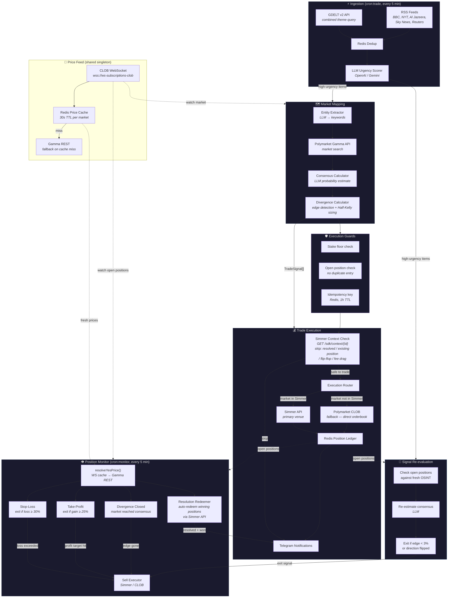

# Polymarket Geopolitical Trading Agent

Autonomous agent that monitors geopolitical OSINT feeds, maps high-urgency events to Polymarket prediction contracts, and executes trades with automatic position management.

## Architecture



### Data Flow Summary

| Cycle | Entrypoint | What happens |
|-------|-----------|--------------|
| **Trade** (`cron:trade`) | `src/execution/index.ts` | Ingest OSINT → apply timing window multiplier → score urgency → watch high-urgency markets on WS feed → map to markets → context check (Simmer) → re-evaluate open positions → execute new trades |
| **Monitor** (`cron:monitor`) | `src/monitor/index.ts` | Resolve prices via WS cache (Gamma REST fallback) → evaluate stop-loss / take-profit / divergence → exit if triggered → auto-redeem resolved winning positions |
| **Spot** (`cron:spot`) | `src/spot/index.ts` | Poll spot prices → detect significant moves → cross-check Simmer oracle opportunities → find correlated markets → watch on WS feed → estimate probability → execute trades |

### Exit Priority

| Priority | Trigger | Cost | Where |
|----------|---------|------|-------|
| 1 | **Stop-loss** — loss ≥ 30% | Free (price check) | Monitor cycle |
| 2 | **Take-profit** — gain ≥ 25% | Free (price check) | Monitor cycle |
| 3 | **Signal re-eval** — edge evaporated | LLM call | Trade cycle |
| 4 | **Divergence closed** — market reached consensus | Free (price check) | Monitor cycle |

### Execution Venues

| Venue | When used | Auth |
|-------|-----------|------|
| **Simmer** (primary) | Market exists in Simmer catalogue | `SIMMER_API_KEY` |
| **Polymarket CLOB** (fallback) | Market not in Simmer | `POLYGON_WALLET_PRIVATE_KEY` (local signing) |

### Price Resolution

All price lookups go through `resolveYesPrice()`, which checks the CLOB WebSocket cache (Redis, 30s TTL) before falling back to Gamma REST. A single `ClobPriceFeed` singleton subscribes to market order-book updates for all watched markets:

- High-urgency OSINT markets are subscribed when they enter the divergence calculator
- Spot-triggered correlated markets are subscribed at trade time
- Open position markets are subscribed at monitor startup

Set `WS_ENABLED=false` to disable WebSocket subscriptions (REST-only mode; useful in test environments).

### Pre-Trade Context Check (Simmer)

Before every Simmer trade, `executor.ts` calls `GET /api/sdk/context/{market_id}` and skips the trade if:

- Market is resolved or closed
- Simmer already sees an open position on the same side (prevents doubling up)
- Simmer flags a severe flip-flop warning (signal instability)
- Market has fees (fee drag erodes geopolitical edge at typical stake sizes)

### Auto-Redemption

The monitor cycle automatically redeems winning positions on resolved markets via the Simmer API (`resolutionRedeemer.ts`). Redemptions are Telegram-notified with the profit amount.

### Timing Window Multiplier

OSINT urgency scores are boosted by a regional timing window after LLM scoring:

| Window (UTC) | Region | Multiplier | Rationale |
|---|---|---|---|
| 00:00 – 08:00 | Asia/Pacific | ×1.20 | US asleep — geopolitical repricing lag is widest |
| 06:00 – 14:00 | Europe/Middle East | ×1.15 | US waking — partial repricing lag |
| Outside windows | — | ×1.00 | No adjustment |

Scores are capped at 10. Configure via `TIMING_WINDOW_ENABLED` (default `true`).

## Setup

```bash
# 1. Start Redis
docker run -d --name pga-redis --restart unless-stopped -p 6379:6379 redis:alpine
# REDIS_URL=redis://localhost:6379
#
# Or use a custom port (e.g. if 6379 is taken):
# docker run -d --name pga-redis --restart unless-stopped -p 6385:6379 redis:alpine
# REDIS_URL=redis://localhost:6385

# 2. Install dependencies
npm install

# 3. Configure environment
cp .env.example .env
# Required: REDIS_URL, SIMMER_API_KEY, OPENAI_API_KEY (or GEMINI_API_KEY),
#           TELEGRAM_BOT_TOKEN, TELEGRAM_CHAT_ID, POLYGON_WALLET_PRIVATE_KEY
# See .env.example for all optional tuning knobs.

# 4. Verify build
npm run build

# 5. Probe Simmer connectivity
npm run probe:simmer

# 6. Run trade + monitor cycles via cron (every 5 min)
# See crontab example below.
```

### Crontab

Cron runs in a stripped environment and won't load your `.env` automatically. A `run.sh` wrapper script is included in the project root. It handles `.env` loading and uses `flock(1)` to prevent overlapping cron runs (important on low-memory hosts like Raspberry Pi).

The script already exists — just reference it in your crontab:

```cron
PATH=/usr/local/bin:/usr/bin:/bin
# On Raspberry Pi / Linux with nvm: PATH=/home/<user>/.nvm/versions/node/<version>/bin:/usr/local/bin:/usr/bin:/bin

*/5 * * * * /path/to/polymarket-geopolitical-agent/run.sh npx tsx /path/to/polymarket-geopolitical-agent/src/execution/index.ts >> /tmp/pga-trade.log 2>&1
*/5 * * * * /path/to/polymarket-geopolitical-agent/run.sh npx tsx /path/to/polymarket-geopolitical-agent/src/monitor/index.ts >> /tmp/pga-monitor.log 2>&1
* * * * *   /path/to/polymarket-geopolitical-agent/run.sh npx tsx /path/to/polymarket-geopolitical-agent/src/spot/index.ts >> /tmp/pga-spot.log 2>&1
*/15 * * * * /path/to/polymarket-geopolitical-agent/run.sh npx tsx /path/to/polymarket-geopolitical-agent/src/arb/index.ts >> /tmp/pga-arb.log 2>&1
```

#### Overlap protection

| Layer | Applies to | Mechanism | Protects against |
|---|---|---|---|
| `flock` in `run.sh` | All pipelines | OS-level file lock per script (`/tmp/pga-<script>.lock`) | Second cron tick firing while prior OS process is still alive |
| Redis overlap lock | `execution`, `monitor`, `spot` | Token-based `SET ... EX NX` + Lua compare-and-delete release | Slow cycle (LLM latency, Simmer API) running longer than the lock TTL; prevents a long-running process from releasing a lock it no longer owns |
| WebSocket feed cleanup | `monitor`, `spot` | `destroyPriceFeed()` in `finally` | Open WS connection holding the Node event loop open after work is done |

The Redis lock uses token-based ownership: each run stores a unique token on acquire and releases with a Lua script that only deletes if the stored value still matches. This prevents an expired long-running process from evicting a newer run's lock.

`arb` only uses `flock` (its cycles are short and have no WS feed); the Redis lock applies to the three pipelines that make LLM calls.

## Scripts

| Script | Description |
|---|---|
| `npm run build` | TypeScript type-check (no emit) |
| `npm run probe:simmer` | Verify Simmer SDK connectivity |
| `npm run cron:trade` | Run the full trade pipeline (ingest → map → re-eval → execute) |
| `npm run cron:monitor` | Run the position monitor (stop-loss / take-profit / divergence) |
| `npm run cron:spot` | Run the spot price monitor (price moves → correlated market trades) |
| `npm run lint` | ESLint |
| `npm run format` | Prettier |
| `npm test` | Jest tests |

## Module Documentation

| Module | README | Description |
|--------|--------|-------------|
| `src/shared/` | [README](src/shared/README.md) | Config, Redis client, Simmer SDK wrapper (`context` + `opportunities` endpoints), CLOB WebSocket feed, price cache, logger |
| `src/ingestion/` | [README](src/ingestion/README.md) | RSS + Cheerio scraping, Redis dedup, LLM urgency scoring, timing window multiplier |
| `src/mapping/` | [README](src/mapping/README.md) | Gamma API client, entity extraction, consensus probability, Half-Kelly sizing |
| `src/execution/` | [README](src/execution/README.md) | Simmer pre-trade context check, execution router, Redis position ledger, Telegram notifications |
| `src/monitor/` | [README](src/monitor/README.md) | WS-backed price resolution, stop-loss / take-profit / divergence evaluator, auto-redemption of resolved positions |
| `src/spot/` | — | Spot price monitor: polls CoinGecko/Yahoo Finance, Simmer oracle cross-check, correlates to Polymarket, executes trades |

## Phases

See [docs/PHASES.md](docs/PHASES.md) for the full phase breakdown.
See [docs/PRD.md](docs/PRD.md) for product requirements.

## Environment Variables

See `.env.example` for full documentation of all required and optional variables.

## Development Notes

- **One PR per phase.** Tasks within a phase are tracked as GitHub sub-issues under the phase epic.
- **Romeo merges all PRs.** Never merge your own work.
- Phase 0: scaffolding + Simmer SDK validation.
- Phase 1: ingestion & urgency scoring.
- Phase 2: market mapping & execution logic.
- Phase 3: execution orchestration & Telegram notifications.
- Phase 4: position monitor & take-profit.
- Phase 5: spot price monitor — parallel signal source from live asset prices.
# Test
