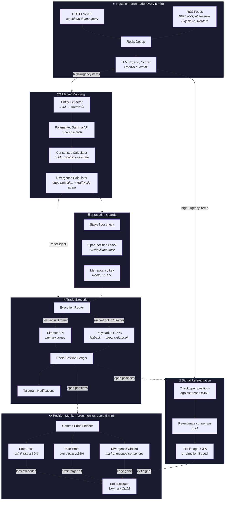

# Polymarket Geopolitical Trading Agent

Autonomous agent that monitors geopolitical OSINT feeds, maps high-urgency events to Polymarket prediction contracts, and executes trades with automatic position management.

## Architecture



### Data Flow Summary

| Cycle | Entrypoint | What happens |
|-------|-----------|--------------|
| **Trade** (`cron:trade`) | `src/execution/index.ts` | Ingest OSINT → score urgency → map to markets → re-evaluate open positions → execute new trades |
| **Monitor** (`cron:monitor`) | `src/monitor/index.ts` | Fetch prices for open positions → evaluate stop-loss / take-profit / divergence → exit if triggered |

### Exit Priority

| Priority | Trigger | Cost | Where |
|----------|---------|------|-------|
| 1 | **Stop-loss** — loss ≥ 30% | Free (price check) | Monitor cycle |
| 2 | **Take-profit** — gain ≥ 25% | Free (price check) | Monitor cycle |
| 3 | **Signal re-eval** — edge evaporated | LLM call | Trade cycle |
| 4 | **Divergence closed** — market reached consensus | Free (price check) | Monitor cycle |

### Execution Venues

| Venue | When used | Auth |
|-------|-----------|------|
| **Simmer** (primary) | Market exists in Simmer catalogue | `SIMMER_API_KEY` |
| **Polymarket CLOB** (fallback) | Market not in Simmer | `POLYGON_WALLET_PRIVATE_KEY` (local signing) |

## Setup

```bash
# 1. Install dependencies
npm install

# 2. Configure environment
cp .env.example .env
# Required: REDIS_URL, SIMMER_API_KEY, OPENAI_API_KEY (or GEMINI_API_KEY),
#           TELEGRAM_BOT_TOKEN, TELEGRAM_CHAT_ID, POLYGON_WALLET_PRIVATE_KEY
# See .env.example for all optional tuning knobs.

# 3. Verify build
npm run build

# 4. Probe Simmer connectivity
npm run probe:simmer

# 5. Run trade + monitor cycles via cron (every 5 min)
# See crontab example below.
```

### Crontab

```cron
PATH=/opt/homebrew/bin:/usr/local/bin:/usr/bin:/bin

*/5 * * * * cd /path/to/polymarket-geopolitical-agent && npx tsx src/execution/index.ts >> /tmp/pga-trade.log 2>&1
*/5 * * * * cd /path/to/polymarket-geopolitical-agent && npx tsx src/monitor/index.ts >> /tmp/pga-monitor.log 2>&1
```

## Scripts

| Script | Description |
|---|---|
| `npm run build` | TypeScript type-check (no emit) |
| `npm run probe:simmer` | Verify Simmer SDK connectivity |
| `npm run cron:trade` | Run the full trade pipeline (ingest → map → re-eval → execute) |
| `npm run cron:monitor` | Run the position monitor (stop-loss / take-profit / divergence) |
| `npm run lint` | ESLint |
| `npm run format` | Prettier |
| `npm test` | Jest tests |

## Module Documentation

| Module | README | Description |
|--------|--------|-------------|
| `src/shared/` | [README](src/shared/README.md) | Config, Redis client, Simmer SDK wrapper, logger |
| `src/ingestion/` | [README](src/ingestion/README.md) | RSS + Cheerio scraping, Redis dedup, LLM urgency scoring |
| `src/mapping/` | [README](src/mapping/README.md) | Gamma API client, entity extraction, consensus probability, Half-Kelly sizing |
| `src/execution/` | [README](src/execution/README.md) | Simmer trade execution, Redis position ledger, Telegram notifications |
| `src/monitor/` | [README](src/monitor/README.md) | Position monitor, take-profit evaluator + executor |

## Phases

See [docs/PHASES.md](docs/PHASES.md) for the full phase breakdown.
See [docs/PRD.md](docs/PRD.md) for product requirements.

## Environment Variables

See `.env.example` for full documentation of all required and optional variables.

## Development Notes

- **One PR per phase.** Tasks within a phase are tracked as GitHub sub-issues under the phase epic.
- **Romeo merges all PRs.** Never merge your own work.
- Phase 0: scaffolding + Simmer SDK validation.
- Phase 1: ingestion & urgency scoring.
- Phase 2: market mapping & execution logic.
- Phase 3: execution orchestration & Telegram notifications.
- Phase 4: position monitor & take-profit.
# Test
