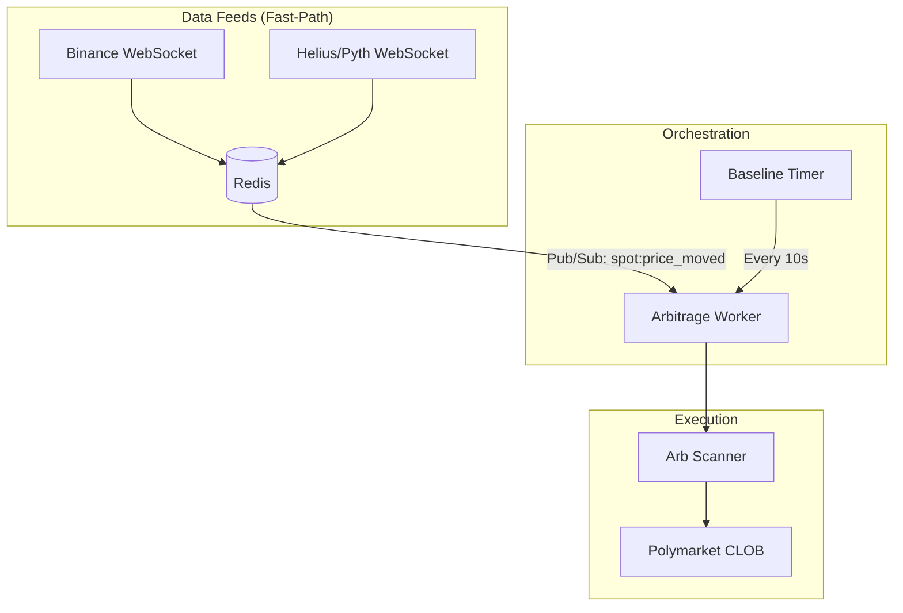

# High-Speed Arbitrage Worker

This guide explains the architecture of the long-running arbitrage worker and the real-time data feeds.

## Architecture



## How it Works

### 1. Fast-Path Triggering
The `BinanceFeed` and `HeliusFeed` maintain persistent WebSocket connections to external exchanges and the Solana blockchain. 
When a price update occurs:
1. The new price is updated in Redis.
2. A `spot:price_moved` event is published.
3. The `ArbitrageWorker` receives the event and immediately triggers a scan of Polymarket.

### 2. Rate Limiting (Governor)
To protect your Polymarket account from rate-limiting flags, the worker includes a **Governor**.
- **Max Trades Per Minute**: Configured via `MAX_TRADES_PER_MIN` (default: 45).
- If multiple price moves occur within the throttle window (e.g., 1.3s), the worker will bundle or skip triggers to maintain safety.

### 3. Baseline Scanning
Even if no external price moves are detected, the worker performs a "Baseline Scan" every 10 seconds. This catches "pure" arbitrage opportunities inside Polymarket (where YES + NO < $1.00) that aren't driven by external price action.

## Configuration

| Variable | Description | Default |
| :--- | :--- | :--- |
| `BINANCE_WS_ENABLED` | Enable the Binance price feed | `true` |
| `HELIUS_API_KEY` | Your Helius API Key (required for SOL arb) | - |
| `ARB_WORKER_ENABLED` | Enable the long-running worker | `true` |
| `BINANCE_SYMBOLS` | Tickers to monitor (comma-separated) | `btcusdt,ethusdt,solusdt` |

## Running the Workers

To run the system in high-speed mode, you should start both the feed manager and the arb worker as separate processes:

```bash
# Terminal 1: Feed Manager
npm run worker:spot-feed

# Terminal 2: Arbitrage Worker
npm run worker:arb
```
